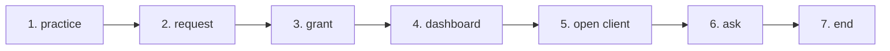

# FLOW — C2V · Client to verified (the practice door) — the PM1-style rows (round CA1 · reworked CA1b · 2026-10-13)

The machine form is in `docs/process/flows.json` (flow `C2V`; the guard `e2e/process-map.cjs` allows a MISSING row that names no file
and carries its evidence, so the rows are in). `docs/process/C2V.md` is the generated page; this file says WHY each row is as it is and
what each step will cite once built (the CA2/CA3 rows to fill in, so the map does not rot).

SAP picture: none — SAP has no "many clients, one accountant console". The incumbents (Xero HQ / Partner Hub, QBOA → Intuit Accountant
Suite, MYOB Practice — `docs/research/COMPARE-AU-BOOKS-2026-10.md` §2) are a BASELINE only: this flow is built on our construct
(REQUIREMENT §0): a sealed Ledger read under a grant · bills that arrive as chits both parties hold · a question as a message on the
record · the hash-chained pack the client acknowledges · the nightly recompute · the one IAM. Nothing of theirs is reused: not the
insight columns, not "Ask client", not the invite expiry.

Module: every step sits on **Accounts** for now — the thing seen and acted on is the client's Ledger. The module row **Practice**
(page `web:public/practice.html`) joins `modules[]` when the page exists (CA3); the guard checks a module's page exists, so it cannot
be added before.

| # | step | who | screen (file · function) | engine function | API route | chit kind | ledger entry | test | status today | evidence / what fills the row |
|---|---|---|---|---|---|---|---|---|---|---|
| 1 | practice | the CA firm (registers as an entity of kind practice) | — | — | — | none | none | — | **MISSING** | `api:lib/entitykind.js` declares supplier · network · actor · shopper · internal · test; `POST /api/entities/register` mints a shop. CA2: `entity_kind = 'practice'` (migration FILE, next free bNNN), `PATCH /api/entities/profile` carries ABN + agent number once AU1's identity slot exists. CA3: `web:public/practice.html` S5. |
| 2 | request | the practice (by the client's handle) or the client owner (by the practice's handle) SENDS a request | — | — | — | none | none | — | **MISSING** | a connection is a status with no scope (`api:db/schema.sql` connections · `net01_network.sql` cb_edge); the only trace is the words "Invite an accountant" (`api:lib/sides.js`). CA2: `POST /api/practice/request` → `practice_grant` status sent (no expiry — a To-do row until answered); the client's To-do kind `practice_request` (`api:lib/books-todo.js`). CA3: C1's handle box; S1's greyed "Request sent" row. |
| 3 | grant | the client OWNER accepts (picks the level) or rejects — the rail's verbs | — | — | — | none | none | — | **MISSING** | no cross-business permission model (`web:docs/DESIGN-NOTES-2026-10.md` §1.2 item 2); one actor row = one shop (`b173`). The LEVELS exist and are reused unchanged: `api:lib/access.js levelOf`, `engines:src/rail.js byLevel`, the sentences `CBRail.WHY`; the verbs are `engines:src/rail.js ACTIONS` accept · reject. CA2: `POST /api/books/practice/accept` · `/reject` · `PATCH /api/books/practice/level`, `practice_grant_event` rows (the `access-events.js` shape), `access.js effectiveLevel()` = min(grant, person). Test: `api:tests/practice-grant.test.cjs`. |
| 4 | dashboard | the practice owner and staff (read): Client · Sealed to · Nightly says | — | — | — | none | none | — | **MISSING** | the per-shop facts exist and are stored: `api:lib/books-nightly.js check()` → `books_setting.last_check` (`problems[]`, `at`); `api:lib/books-pack.js build` (`sha256` · `prev_sha256`) + `POST /api/books/packs/:id/ack` (`acknowledged_at`) + `engines:src/bookpack.js verify()`; `api:lib/books.js periodAdvice()`; `api:lib/books-todo.js todo()`; `engines:src/reg-au.js basPeriods()` (statutory BAS due). No cross-client read (RLS per entity; `ops.f_books_enabled` is ids only); no stored "sealed to" word. CA2: `last_check.summary` (FIELDS entry) + `ops.f_practice_clients(uuid)` + `GET /api/practice/clients` (one trip, budget line by hand). CA3: `practice.html` S1 = one `CBList` mount, `e2e/walk-practice.cjs`. |
| 5 | open client | a practice person, one click into the client's Ledger (reads a sealed record; nothing copied out) | — | — | — | none | none | — | **MISSING** | one token = one shop (`api:middleware/auth.js entityOf`); a person session is minted for the person's own shop only (`api:lib/person-session.js`). CA2: `POST /api/practice/clients/:id/open` mints a client-scoped person session (entity = client, actor = practice person, level = effectiveLevel), writes a `practice_open` row. CA3: the strip on `accounts.html` / `finance.html` ("You are in ‹client› as ‹practice› · ‹level›"), C1's "who opened" list. |
| 6 | ask | a practice person asks ON THE CHIT: a commenter the client's team (internal), an editor also the client's supplier (external); each answers in its own login | `web:public/app/rail-thread.js` `mount()` · `send()` · `web:public/app/cap-messages.js` | `api:lib/access.js` `canMessage()` · `engines:src/rail.js` `byLevel()` | `POST /api/chits/:chit_id/messages` · `GET /api/chits/:chit_id/messages` (`api:routes/chits.js`) | a message on the client's chit (msg_type query, exists), internal or external thread | none | `web:e2e/rail-thread-guard.cjs` · `api:tests/iam-access.test.cjs` · `engines:tests/rail.test.js` | ⚠️ built, gap named | the ONE composer, the ladder and `msg_type = 'query'` (baseline CHECK) are reused as they are; no due date, no answered flag — the thread's last message says whose turn it is (REQUIREMENT §9). Missing: the anchor for a MONTH's question (the pack as a message subject — owner Q1, decided before CA2); the cross-client count `threads_waiting_on_client` in `last_check.summary`. CA3: Replies (S3) across clients, bulk "Ask n clients". |
| 7 | end | the client owner (any time) or the practice (ends the engagement; from SENT = withdraws) | — | — | — | none | none | — | **MISSING** | nothing to end yet (step 3). The mechanism exists: a session is as alive as its listing, an end is refused everywhere within 60 s (`person-session.js` CACHE_MS); the ledger is insert-only, so what the practice posted stays, stamped by the person. CA2: `POST /api/books/practice/end` · `POST /api/practice/clients/:id/end` → every session minted from the grant delisted. CA3: C1's *End access* button, S1's "Ended" row. |

## Where the flow touches the existing maps

- **R2R step 3 · month lock** and **step 4 · GST**: the practice's editor does these INSIDE the client's session — the same functions
  (`api:lib/books.js setPeriod`, `api:lib/books-period.js gstClose`), the same screens (`cap-books.js bkLockDo`, `cap-period.js peGstClose`).
  No new path. The owner-only gate (`owner` middleware on those routes) becomes "owner, or an editor-level practice session" — CA2 names
  each route it widens.
- **R2R step 6 · statements**: "a CA (the handover pack)" is already the `who`; the practice door reads the same pack
  (`GET /api/books/packs`, `engines:src/bookpack.js verify`) — and "Sealed to" is that pack's chain and acknowledgement, read.
- **H2P step 2 · access**: the practice's own people get their level exactly there (`PATCH /api/actors/:id`, `access-events`).
- **O2C / P2P**: untouched — a question hangs on the chit those flows made; the supplier answers on their copy as in any O2C thread.

## How the rows are kept true

A function built in CA2/CA3 replaces the "—" in its row in `flows.json` in the same PR (`node tools/gen-process-docs.cjs`, then
`node e2e/process-map.cjs` must pass with the api and engines checkouts beside this repo). A MISSING row that gains a file flips to
`ok` or `warn`; it never keeps a file AND the word MISSING (the guard refuses that).
