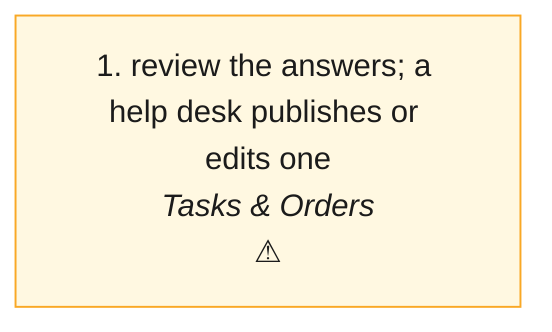

# AST · CB Assist (what the assistant answers: the help desk's knowledge base) — the process map from the code

<!-- GENERATED by tools/gen-process-docs.cjs from docs/process/flows.json — edit the JSON, then run the tool. -->

SAP picture: **no SAP module**. One row per step: who does it · the screen · the engine function · the API route · the chit kind · the ledger entry · the test · status. A file is `repo:path` (web = this repo · api = chitbridge-api · engines = chitbridge-engines). A step marked **MISSING** has nothing in the code that does it — the evidence is in its row, nothing is invented. Generated 2026-10-12.

| # | step | module | who | screen (file · function) | engine function | API route | chit kind | ledger entry | test | status |
|---|---|---|---|---|---|---|---|---|---|---|
| 1 | review the answers; a help desk publishes or edits one | Tasks & Orders | anyone reads; a help desk publishes (whoami may.publish greys it for others, with the sentence) | `web:public/app/cap-assist.js` `CBAssist()` `web:public/app/cap-assist.js` `loadGaps()` | `api:routes/assist.js` `router()` | `GET /questions` `api:routes/assist.js` `GET /whoami` `api:routes/assist.js` `POST /publish` `api:routes/assist.js` | none (a question reaches the help desk as a chit in its Tasks; the answer is published here) | none | `api:tests/disputes-small-app.test.cjs` `web:e2e/walk-disputes.cjs` | ⚠️ — Accept / reject of what the assistant DRAFTED is not built: the server keeps no drafts (GET /assist/gaps answers [] · POST /assist/resolve 410). |

## The backlog this map leaves

- **step 1 · review the answers; a help desk publishes or edits one** — ⚠️ — Accept / reject of what the assistant DRAFTED is not built: the server keeps no drafts (GET /assist/gaps answers [] · POST /assist/resolve 410).
