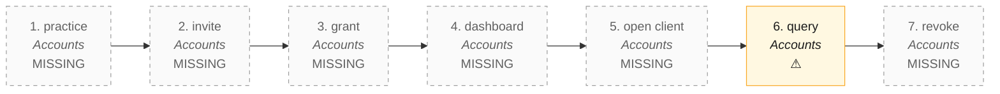

# C2V · Client to verified (the practice door) — the process map from the code

<!-- GENERATED by tools/gen-process-docs.cjs from docs/process/flows.json — edit the JSON, then run the tool. -->

SAP picture: **no SAP module — the Xero HQ / QBOA / MYOB Practice pattern (docs/research/COMPARE-AU-BOOKS-2026-10.md §2); design in docs/design/practice-door/**. One row per step: who does it · the screen · the engine function · the API route · the chit kind · the ledger entry · the test · status. A file is `repo:path` (web = this repo · api = chitbridge-api · engines = chitbridge-engines). A step marked **MISSING** has nothing in the code that does it — the evidence is in its row, nothing is invented. Generated 2026-10-12.

| # | step | module | who | screen (file · function) | engine function | API route | chit kind | ledger entry | test | status |
|---|---|---|---|---|---|---|---|---|---|---|
| 1 | practice | Accounts | the CA firm (registers as an entity of kind practice) | — | — | — | none | none | — | MISSING — No entity kind 'practice': api lib/entitykind.js declares supplier · network · actor · shopper · internal · test only; POST /api/entities/register (routes/entities.js) mints a shop. The practice page (web:public/practice.html) does not exist; its module row joins modules[] when it does (round CA3). |
| 2 | invite | Accounts | the practice (by the client's handle) or the client owner (by the practice's handle) | — | — | — | none | none | — | MISSING — Nothing lets one entity ask another for access: a connection is a status with no scope (api db/schema.sql connections; migrations/net01_network.sql cb_edge) and the only trace is the empty-state words 'Invite an accountant' in api lib/sides.js. Planned: practice_grant row status=invited (migration FILE b299, round CA2). |
| 3 | grant | Accounts | the client OWNER (accepts and picks the level: viewer · commenter · editor) | — | — | — | none | none | — | MISSING — No cross-business permission model (web docs/DESIGN-NOTES-2026-10.md §1.2 item 2): one actor row = one shop (api migrations/b173_access_level.sql), whole_entity is entity-scoped by design. The three levels and their ladder EXIST (api lib/access.js levelOf, engines src/rail.js byLevel) and are reused unchanged; what is missing is the edge that carries one between two entities, and its event log (the access-events.js shape). |
| 4 | dashboard | Accounts | the practice owner and staff (read) | — | — | — | none | none | — | MISSING — No cross-client read: api lib/books-nightly.js check() stores books_setting.last_check per shop and lib/books-todo.js todo() lists one shop's to-do, but nothing lists them across the shops a practice holds (RLS is per entity; the one cross-shop read is ops.f_books_enabled, ids only). web public/app/cap-network.js is commerce-only, no finance figures. Planned: last_check.summary + ops.f_practice_clients + GET /api/practice/clients (CA2), practice.html S1 (CA3). |
| 5 | open client | Accounts | a practice person (one click into the client's CB Accounts) | — | — | — | none | none | — | MISSING — One token = one shop (api middleware/auth.js entityOf); a person session (lib/person-session.js) is minted for the person's own shop only. Nothing mints a client-scoped session from a grant, and nothing records an open of the books by name (access_events records access CHANGES only). Planned: POST /api/practice/clients/:id/open + practice_open rows (CA2). |
| 6 | query | Accounts | a practice person (commenter or editor) asks; the client's team answers in its own login | `web:public/app/rail-thread.js` `mount()` `web:public/app/rail-thread.js` `send()` `web:public/app/cap-messages.js` | `api:lib/access.js` `canMessage()` `engines:src/rail.js` `byLevel()` | `POST /api/chits/:chit_id/messages` `api:routes/chits.js` `GET /api/chits/:chit_id/messages` `api:routes/chits.js` | a message on the client's chit, internal thread, msg_type query | none | `web:e2e/rail-thread-guard.cjs` `api:tests/iam-access.test.cjs` `engines:tests/rail.test.js` | ⚠️ — The ONE composer (CBThread) and the ladder (a commenter posts internally, a viewer reads and sees the sentence) exist and are reused as they are. Missing: msg_type 'query' as a known kind with a due date and an answered flag; and an anchor for a query on a ledger entry that is not a chit (REQUIREMENT §9: a per-client review chit, or entry_id as a subject — the owner decides before CA2). |
| 7 | revoke | Accounts | the client owner (any time) or the practice (ends the engagement) | — | — | — | none | none | — | MISSING — Nothing to revoke yet (step 3). The mechanism it will use exists: a person session is as alive as its listing and a revoke is refused everywhere within 60 s (api lib/person-session.js CACHE_MS); the ledger is insert-only, so what the practice posted stays, stamped by the person (app.current_actor). |

## The backlog this map leaves

- **step 1 · practice** — MISSING — No entity kind 'practice': api lib/entitykind.js declares supplier · network · actor · shopper · internal · test only; POST /api/entities/register (routes/entities.js) mints a shop. The practice page (web:public/practice.html) does not exist; its module row joins modules[] when it does (round CA3).
- **step 2 · invite** — MISSING — Nothing lets one entity ask another for access: a connection is a status with no scope (api db/schema.sql connections; migrations/net01_network.sql cb_edge) and the only trace is the empty-state words 'Invite an accountant' in api lib/sides.js. Planned: practice_grant row status=invited (migration FILE b299, round CA2).
- **step 3 · grant** — MISSING — No cross-business permission model (web docs/DESIGN-NOTES-2026-10.md §1.2 item 2): one actor row = one shop (api migrations/b173_access_level.sql), whole_entity is entity-scoped by design. The three levels and their ladder EXIST (api lib/access.js levelOf, engines src/rail.js byLevel) and are reused unchanged; what is missing is the edge that carries one between two entities, and its event log (the access-events.js shape).
- **step 4 · dashboard** — MISSING — No cross-client read: api lib/books-nightly.js check() stores books_setting.last_check per shop and lib/books-todo.js todo() lists one shop's to-do, but nothing lists them across the shops a practice holds (RLS is per entity; the one cross-shop read is ops.f_books_enabled, ids only). web public/app/cap-network.js is commerce-only, no finance figures. Planned: last_check.summary + ops.f_practice_clients + GET /api/practice/clients (CA2), practice.html S1 (CA3).
- **step 5 · open client** — MISSING — One token = one shop (api middleware/auth.js entityOf); a person session (lib/person-session.js) is minted for the person's own shop only. Nothing mints a client-scoped session from a grant, and nothing records an open of the books by name (access_events records access CHANGES only). Planned: POST /api/practice/clients/:id/open + practice_open rows (CA2).
- **step 6 · query** — ⚠️ — The ONE composer (CBThread) and the ladder (a commenter posts internally, a viewer reads and sees the sentence) exist and are reused as they are. Missing: msg_type 'query' as a known kind with a due date and an answered flag; and an anchor for a query on a ledger entry that is not a chit (REQUIREMENT §9: a per-client review chit, or entry_id as a subject — the owner decides before CA2).
- **step 7 · revoke** — MISSING — Nothing to revoke yet (step 3). The mechanism it will use exists: a person session is as alive as its listing and a revoke is refused everywhere within 60 s (api lib/person-session.js CACHE_MS); the ledger is insert-only, so what the practice posted stays, stamped by the person (app.current_actor).
