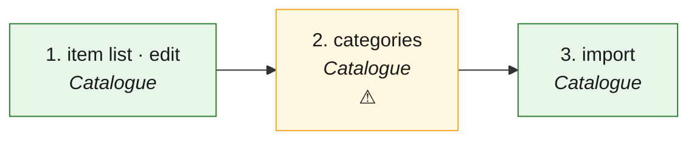

# CAT · Catalogue (what the shop sells) — the process map from the code

<!-- GENERATED by tools/gen-process-docs.cjs from docs/process/flows.json — edit the JSON, then run the tool. -->

SAP picture: **MM (material master) · SD (condition records)**. One row per step: who does it · the screen · the engine function · the API route · the chit kind · the ledger entry · the test · status. A file is `repo:path` (web = this repo · api = chitbridge-api · engines = chitbridge-engines). A step marked **MISSING** has nothing in the code that does it — the evidence is in its row, nothing is invented. Generated 2026-10-12.

| # | step | module | who | screen (file · function) | engine function | API route | chit kind | ledger entry | test | status |
|---|---|---|---|---|---|---|---|---|---|---|
| 1 | item list · edit | Catalogue | the owner, or a co-assist (availability only without "Sees costs") | `web:public/app/cap-catalogue.js` `readItems()` `web:public/app/cap-catalogue.js` `openItem()` `web:public/app/cap-catalogue.js` `save()` | `api:lib/money.js` `stampItem()` `api:lib/cost.js` `canRead()` | `GET /api/products` `api:routes/products.js` `PATCH /api/products/:id` `api:routes/products.js` `POST /api/products` `api:routes/products.js` `GET /api/entities/me/can-see-costs` `api:routes/entities.js` | none — the catalogue is master data; a chit freezes the line it cites | none | `api:tests/offr04-cost-gate.test.cjs` `api:tests/cost-never-to-employees.test.cjs` `web:e2e/walk-catalogue.cjs` | ✅ — PATCH merge:true is an RFC 7386 patch (null removes a key). The server strips cost for a cost-blind caller and refuses that caller anything but status (OFFR-04). Sort is the server's one order, newest first. |
| 2 | categories | Catalogue | the owner | `web:public/app/cap-catalogue.js` `showCats()` `web:public/app/cap-catalogue.js` `saveCat()` `web:public/app/cap-catalogue.js` `lifeCat()` `web:public/app/core.js` `cbCatgCreate()` | — | `GET /api/definitions` `api:routes/definitions.js` `POST /api/definitions` `api:routes/definitions.js` `PUT /api/definitions/:id` `api:routes/definitions.js` `DELETE /api/definitions/:id` `api:routes/definitions.js` | none | none | `web:e2e/walk-catalogue.cjs` | ⚠️ — No engine function: a category is a definition row of kind category, retired never deleted. PUT replaces rules whole, so a rename re-sends them. |
| 3 | import | Catalogue | the owner | `web:public/app/cap-catalogue.js` `impPick()` `web:public/app/cap-catalogue.js` `impSend()` `web:public/app/catalogue-lines.js` `cbImportVerdict()` | `api:lib/csv-preflight.js` `preflight()` `api:lib/csv-preflight.js` `applyDecisions()` | `POST /api/products/import/preflight` `api:routes/products.js` `POST /api/products/import` `api:routes/products.js` | none | none | `api:tests/csv-preflight.test.js` `web:e2e/walk-catalogue.cjs` | ✅ — The preflight writes nothing; the import re-runs it on the server, refuses while a row has an error, and never deletes. |

## The backlog this map leaves

- **step 2 · categories** — ⚠️ — No engine function: a category is a definition row of kind category, retired never deleted. PUT replaces rules whole, so a rename re-sends them.
