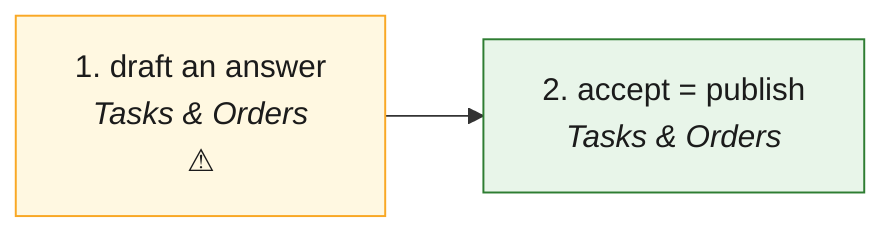

# CBA · Question to answer (CB Assist) — the process map from the code

<!-- GENERATED by tools/gen-process-docs.cjs from docs/process/flows.json — edit the JSON, then run the tool. -->

SAP picture: **— (the help desk's knowledge base)**. One row per step: who does it · the screen · the engine function · the API route · the chit kind · the ledger entry · the test · status. A file is `repo:path` (web = this repo · api = chitbridge-api · engines = chitbridge-engines). A step marked **MISSING** has nothing in the code that does it — the evidence is in its row, nothing is invented. Generated 2026-10-12.

| # | step | module | who | screen (file · function) | engine function | API route | chit kind | ledger entry | test | status |
|---|---|---|---|---|---|---|---|---|---|---|
| 1 | draft an answer | Tasks & Orders | the help desk; CB Assist proposes | `web:public/app/cap-assist.js` `draft()` | `api:lib/ai.js` `invokeSkill()` | `POST /api/governance/ai-draft` `api:routes/governance.js` | none | none | `web:e2e/walk-disputes.cjs` | ⚠️ — A draft is never stored: Accept publishes it, Reject throws it away (the old gap queue is retired: /assist/gaps · /assist/resolve). |
| 2 | accept = publish | Tasks & Orders | the help desk (others see it greyed, with why) | `web:public/app/cap-assist.js` `publish()` `web:public/app/cap-admin.js` `publishAnswer()` | — | `GET /api/assist/whoami` `api:routes/assist.js` `POST /api/assist/publish` `api:routes/assist.js` `GET /api/assist/questions` `api:routes/assist.js` | none | none | `web:e2e/walk-disputes.cjs` | ✅ — Publish is shown always, greyed with the server's sentence (whoami actions.publish). |

## The backlog this map leaves

- **step 1 · draft an answer** — ⚠️ — A draft is never stored: Accept publishes it, Reject throws it away (the old gap queue is retired: /assist/gaps · /assist/resolve).
