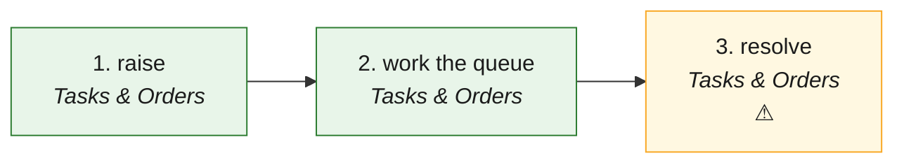

# DSP · Dispute to settled (the USP: per-party, confidential) — the process map from the code

<!-- GENERATED by tools/gen-process-docs.cjs from docs/process/flows.json — edit the JSON, then run the tool. -->

SAP picture: **SD-CM (complaints) · FI-AR (disputed items)**. One row per step: who does it · the screen · the engine function · the API route · the chit kind · the ledger entry · the test · status. A file is `repo:path` (web = this repo · api = chitbridge-api · engines = chitbridge-engines). A step marked **MISSING** has nothing in the code that does it — the evidence is in its row, nothing is invented. Generated 2026-10-12.

| # | step | module | who | screen (file · function) | engine function | API route | chit kind | ledger entry | test | status |
|---|---|---|---|---|---|---|---|---|---|---|
| 1 | raise | Tasks & Orders | a party on the chit (an editor of the shop) | `web:public/app/cap-dispute.js` `raise()` `web:public/app/cap-dispute.js` `quickDispute()` | `api:lib/dispute-may.js` `raise()` `api:lib/rail.js` `can()` | `GET /api/chits/:chit_id/disputes` `api:routes/chits.js` `POST /api/chits/:chit_id/disputes` `api:routes/chits.js` | the chit itself — a dispute copy per party on the roster (chit_disputes, per-copy RLS) | none (a supplier bill under an open dispute waits — books-hooks buyerGate) | `api:tests/dispute-scoping.test.cjs` `web:e2e/walk-disputes.cjs` | ✅ — Raise is shown always, greyed with the rail's sentence (actions.raise); who it may name is the server's (raise_parties). |
| 2 | work the queue | Tasks & Orders | the shop: what it raised, what is against it | `web:public/app/cap-dispute.js` `listLoad()` `web:public/app/cap-dispute.js` `inSheet()` | — | `GET /api/chits/disputes/queue` `api:routes/chits.js` | read (the chit sheet opens the chit; the dispute's room is its own thread) | none | `api:tests/dispute-scoping.test.cjs` `web:e2e/walk-disputes.cjs` | ✅ — Server-paged (status · side · q · sort · page); the room is CBThread scoped to the dispute's roster. |
| 3 | resolve | Tasks & Orders | the business that raised it — per party or all | `web:public/app/cap-dispute.js` `resolveAsk()` `web:public/app/cap-dispute.js` `resolveDispute()` | `api:lib/dispute-may.js` `resolve()` | `PUT /api/chits/:chit_id/disputes/:dispute_id/resolve` `api:routes/chits.js` | the dispute copies close per party; the raiser's when none is left open | a bill held by the dispute is released (books-hooks afterChit) | `api:tests/dispute-scoping.test.cjs` `web:e2e/walk-disputes.cjs` | ⚠️ — Resolve is not a rail action yet: its rule is composed in api lib/dispute-may (engines change queued: rail ACTIONS + resolve_dispute). |

## The backlog this map leaves

- **step 3 · resolve** — ⚠️ — Resolve is not a rail action yet: its rule is composed in api lib/dispute-may (engines change queued: rail ACTIONS + resolve_dispute).
