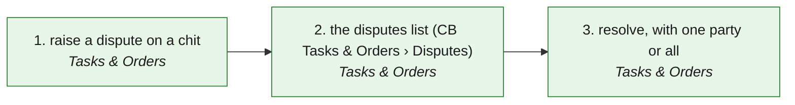

# DSP · Disputes (raise on a chit · the list · resolve, per party) — the process map from the code

<!-- GENERATED by tools/gen-process-docs.cjs from docs/process/flows.json — edit the JSON, then run the tool. -->

SAP picture: **no SAP module — a dispute between two companies' copies is our construct (the rail's USP); an ERP's dispute case lives inside one company**. One row per step: who does it · the screen · the engine function · the API route · the chit kind · the ledger entry · the test · status. A file is `repo:path` (web = this repo · api = chitbridge-api · engines = chitbridge-engines). A step marked **MISSING** has nothing in the code that does it — the evidence is in its row, nothing is invented. Generated 2026-10-12.

| # | step | module | who | screen (file · function) | engine function | API route | chit kind | ledger entry | test | status |
|---|---|---|---|---|---|---|---|---|---|---|
| 1 | raise a dispute on a chit | Tasks & Orders | either party (an editor login; the server's actions.dispute greys it otherwise) | `web:public/app/chit-sheet.js` `actionsFor()` `web:public/app/cap-dispute.js` `quickDispute()` `web:public/app/cap-dispute.js` `confirmDispute()` | `api:lib/rail-actions.js` `actions()` `engines:src/rail.js` `can()` | `POST /:chit_id/disputes` `api:routes/chits.js` | read (the chit; the dispute is one copy per party, per-copy RLS) | none (an open dispute holds a received bill on Waiting — books-hooks buyerGate) | `api:tests/dispute-scoping.test.cjs` `api:tests/rail-actions.test.cjs` `web:e2e/walk-disputes.cjs` | ✅ — T3-DISPUTES-ASSIST: the chit sheet's Dispute is greyed with the chit read's actions.dispute sentence; the form runs on any page with modal(). |
| 2 | the disputes list (CB Tasks & Orders › Disputes) | Tasks & Orders | anyone holding a copy of the disputed chit | `web:public/app/cap-dispute.js` `CBDisputes()` `web:public/tasks.html` `showPane()` | `api:lib/rail-actions.js` `forDispute()` | `GET /disputes/queue` `api:routes/chits.js` | read | none | `api:tests/dispute-scoping.test.cjs` `api:tests/disputes-small-app.test.cjs` `web:e2e/walk-disputes.cjs` | ✅ — The server pages (status · page · limit → total); the screen reads the first 100 and says so. Each row carries side and may.resolve. |
| 3 | resolve, with one party or all | Tasks & Orders | the side that raised it (may.resolve greys it for everyone else, with the sentence) | `web:public/app/cap-dispute.js` `resolveDispute()` `web:public/app/cap-dispute.js` `submitResolve()` | `api:lib/rail-actions.js` `forDispute()` | `PUT /:chit_id/disputes/:dispute_id/resolve` `api:routes/chits.js` | read | a settled dispute releases an accepted bill to post (books-hooks afterChit) | `api:tests/dispute-scoping.test.cjs` `web:e2e/walk-disputes.cjs` | ✅ — Per-party resolve sits in the row's next level when more than one party is still open. |

## The backlog this map leaves

Every step is built and tested.
