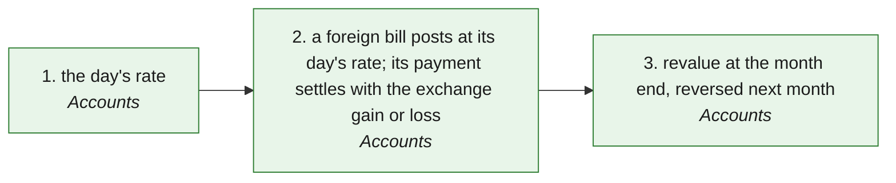

# FX · Foreign currency (a bill in another currency, its settlement, the period-end revaluation) — the process map from the code

<!-- GENERATED by tools/gen-process-docs.cjs from docs/process/flows.json — edit the JSON, then run the tool. -->

SAP picture: **FI (foreign currency valuation · realised / unrealised exchange differences)**. One row per step: who does it · the screen · the engine function · the API route · the chit kind · the ledger entry · the test · status. A file is `repo:path` (web = this repo · api = chitbridge-api · engines = chitbridge-engines). A step marked **MISSING** has nothing in the code that does it — the evidence is in its row, nothing is invented. Generated 2026-10-12.

| # | step | module | who | screen (file · function) | engine function | API route | chit kind | ledger entry | test | status |
|---|---|---|---|---|---|---|---|---|---|---|
| 1 | the day's rate | Accounts | the owner (anyone who reads the books sees the rates) | `web:public/app/cap-fx.js` `fxView()` `web:public/app/cap-fx.js` `fxAddSave()` `web:public/app/cap-fx.js` `fxImport()` | `api:lib/fx-rates.js` `add()` `api:lib/fx-rates.js` `importCsv()` `api:lib/books-store.js` `insertFxRates()` | `GET /api/books/fx-rates` `api:routes/books.js` `POST /api/books/fx-rates` `api:routes/books.js` `POST /api/books/fx-rates/import` `api:routes/books.js` | none | none (a rate is evidence, insert-only) | `api:tests/fx-rates.test.cjs` `web:e2e/walk-fx.cjs` | ✅ — Never fetched, never assumed. Before b391 runs, Add rate is greyed with the sentence. |
| 2 | a foreign bill posts at its day's rate; its payment settles with the exchange gain or loss | Accounts | the hooks (a chit) · the owner (a payment) | `web:public/app/cap-books.js` `bkDuesForeign()` | `api:lib/fx-rates.js` `forEvent()` `api:lib/books.js` `composeEntry()` `engines:src/posting.js` `fx_settlement()` | `GET /api/books/dues` `api:routes/books.js` | read (the bill or invoice chit, in its own currency) | the bill at its day's rate; the payment Dr money at its rate · Cr the party at what the books carry · the difference on 4260 Exchange gain or loss | `engines:tests/fx.test.js` `api:tests/fx-rates.test.cjs` | ✅ — No rate for the day → waits on Waiting, named: No USD rate for 14 Oct — add it in Accounts › Rates. |
| 3 | revalue at the month end, reversed next month | Accounts | the owner, from Month lock | `web:public/app/cap-fx.js` `fxLockLine()` `web:public/app/cap-fx.js` `fxRevalue()` | `api:lib/fx-rates.js` `revaluation()` `api:lib/fx-rates.js` `revalue()` `engines:src/posting.js` `fxRevaluation()` | `GET /api/books/fx-revalue` `api:routes/books.js` `POST /api/books/fx-revalue` `api:routes/books.js` | none | two entries in one transaction: the unrealised difference on 4260 at the month end, its reversal on the next month's first day | `engines:tests/fx.test.js` `api:tests/fx-rates.test.cjs` | ✅ — Debtors and creditors only; a currency with no closing rate is named and nothing is revalued. |

## The backlog this map leaves

Every step is built and tested.
