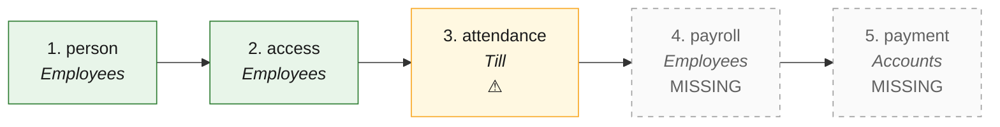

# H2P · Hire to pay — the process map from the code

<!-- GENERATED by tools/gen-process-docs.cjs from docs/process/flows.json — edit the JSON, then run the tool. -->

SAP picture: **HCM → FI**. One row per step: who does it · the screen · the engine function · the API route · the chit kind · the ledger entry · the test · status. A file is `repo:path` (web = this repo · api = chitbridge-api · engines = chitbridge-engines). A step marked **MISSING** has nothing in the code that does it — the evidence is in its row, nothing is invented. Generated 2026-10-12.

| # | step | module | who | screen (file · function) | engine function | API route | chit kind | ledger entry | test | status |
|---|---|---|---|---|---|---|---|---|---|---|
| 1 | person | Employees | the owner | `web:public/app/cap-employees.js` `openAdd()` `web:public/app/cap-workforce.js` | `api:lib/employee-code.js` `mint()` `api:lib/mintuserid.js` `api:lib/people.js` `view()` | `POST /api/actors` `api:routes/actors.js` `POST /api/actors/suggest-key` `api:routes/actors.js` `GET /api/people` `api:routes/people.js` | none | none | `api:tests/people.test.cjs` `api:tests/employee-code.test.cjs` `api:tests/employee-first-signin.test.cjs` `api:tests/userid.test.cjs` `web:e2e/walk-employees.cjs` `web:e2e/employees-guard.cjs` | ✅ |
| 2 | access | Employees | the owner (sets); the person (signs in) | `web:public/app/cap-employees.js` `resetPin()` `web:public/app/cap-employees.js` `emailPanel()` `web:public/app/signin-ui.js` | `api:lib/access.js` `levelOf()` `api:lib/people.js` `accessWords()` `api:lib/signin.js` `api:lib/person-session.js` `engines:src/signin.js` `api:lib/dev-otp.js` `testerCodeOk()` | `POST /api/actors/set-pin` `api:routes/actors.js` `PUT /api/actors/:id/status` `api:routes/actors.js` `POST /api/actors/login` `api:routes/actors.js` `POST /api/signin/ask` `api:routes/signin.js` `POST /api/signin/verify` `api:routes/signin.js` | none | none | `api:tests/iam-access.test.cjs` `api:tests/people-writes-sec2.test.cjs` `api:tests/signin.test.js` `api:tests/person-session.test.cjs` `api:tests/access-events.test.cjs` `web:tests/signin-ui.test.cjs` `api:tests/tester-code.test.cjs` `web:e2e/signin-code.test.cjs` | ✅ |
| 3 | attendance | Till | the person (at a counter) | `web:public/till.html` `closeCounter()` `web:public/app/cap-employees.js` `openAdd()` | `api:lib/dayopen.js` `api:lib/workpattern.js` `resolveWorkPattern()` `api:lib/access-events.js` `record()` | `POST /api/counters/:id/open` `api:routes/counters.js` `POST /api/counters/:id/release` `api:routes/counters.js` `PUT /api/actors/break` `api:routes/actors.js` `GET /api/actors/access-events` `api:routes/actors.js` | none | none | `api:tests/counter-claim.test.js` `api:tests/counter-gates.test.cjs` `api:tests/access-events.test.cjs` `engines:tests/dayopen.test.js` | ⚠️ — What exists is the counter sign-in, release and break state, and a work PATTERN (shift blueprints). Nothing records a day worked, hours or leave as an attendance register. |
| 4 | payroll | Employees | the owner | — | — | — | none | the chart has 6020 Salaries · 5100 Wages · 2420 Salary and wages payable — no rule fills them | — | MISSING — grep attendance\|payroll\|payslip\|salary over api routes/, lib/ and migrations/ finds nothing outside the chart (engines src/reg-in.js). A salary can only be posted as a typed expense (class salary → 6020). |
| 5 | payment | Accounts | the owner | — | — | — | none | none — posting payment_made needs a creditors party; an employee is not one | — | MISSING — Only POST /api/books/entries (a typed, owner-only journal) can record a salary paid. No employee party, no advice, no payslip. |

## The backlog this map leaves

- **step 3 · attendance** — ⚠️ — What exists is the counter sign-in, release and break state, and a work PATTERN (shift blueprints). Nothing records a day worked, hours or leave as an attendance register.
- **step 4 · payroll** — MISSING — grep attendance|payroll|payslip|salary over api routes/, lib/ and migrations/ finds nothing outside the chart (engines src/reg-in.js). A salary can only be posted as a typed expense (class salary → 6020).
- **step 5 · payment** — MISSING — Only POST /api/books/entries (a typed, owner-only journal) can record a salary paid. No employee party, no advice, no payslip.
