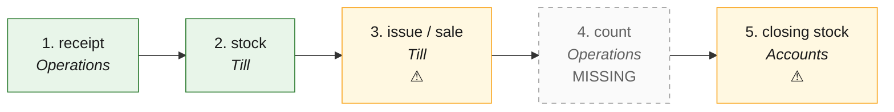

# INV · Inventory — the process map from the code

<!-- GENERATED by tools/gen-process-docs.cjs from docs/process/flows.json — edit the JSON, then run the tool. -->

SAP picture: **MM-IM**. One row per step: who does it · the screen · the engine function · the API route · the chit kind · the ledger entry · the test · status. A file is `repo:path` (web = this repo · api = chitbridge-api · engines = chitbridge-engines). A step marked **MISSING** has nothing in the code that does it — the evidence is in its row, nothing is invented. Generated 2026-10-12.

| # | step | module | who | screen (file · function) | engine function | API route | chit kind | ledger entry | test | status |
|---|---|---|---|---|---|---|---|---|---|---|
| 1 | receipt | Operations | the shop's staff (goods-in; a supply bought) | `web:public/app/cap-chit2.js` `web:public/app/cap-supplies.js` `supAdd()` | `api:lib/deliverline.js` `record()` `api:lib/stock-from-chit.js` `postFor()` `api:lib/stock-store.js` `post()` `api:lib/inventory.js` `api:lib/supply-store.js` `purchase()` | `POST /api/chits/:chit_id/deliver-lines` `api:routes/chits.js` `POST /api/supplies/purchase` `api:routes/supplies.js` | the received bill or order; none for a supply bought | none — IN at landed cost, weighted average (perpetual); a supply bought posts nothing | `api:tests/stock-cycle.test.js` `api:tests/goods-in-accepts.test.cjs` `api:tests/item-cost.test.js` | ✅ — T1-INV (2026-10-14): a supply bought moves stock IN only when the supply is kept, and reaches the books only through a supplier bill (P2P step 4). |
| 2 | stock | Till | the counter, the shop, a connected system; the shopper reads it on the storefront | `web:public/till.html` `stockWrite()` `web:public/shop.html` `shopAskStock()` | `api:lib/stock-store.js` `onHand()` `api:lib/stock-store.js` `sheet()` `api:lib/stock-store.js` `balanceOf()` `api:lib/stock-store.js` `lotsOf()` `api:lib/availability.js` `sourceOf()` `api:lib/availability.js` `withLedger()` `api:lib/catalogue-view.js` `buildPublicView()` `engines:src/lots.js` `check()` | `GET /api/till/stock` `api:routes/till.js` `GET /api/integrations/stock/:handle` `api:routes/integrations.js` `POST /api/till/stock` `api:routes/till.js` `POST /api/till/stock/bulk` `api:routes/till.js` | none | none — quantities only; the books value stock at step 5 | `api:tests/stock-cycle.test.js` `api:tests/lotfields.test.js` `api:tests/traceability-massbalance.test.js` `api:tests/storefront-stock-ledger.test.js` | ✅ — T1-INV (2026-10-14): ONE stock reader (stock-store.onHand). The storefront shows the shop's own ledger; the connector's figure only where a connector owns the shop's stock stream (policy stream_owner.stock). POST /api/till/stock(/bulk) is an availability switch (available/unavailable), never a quantity. |
| 3 | issue / sale | Till | the counter (a bill); staff (a supply used) | `web:public/till.html` `fetchBy()` `web:public/app/cap-supplies.js` `supAdd()` | `api:lib/stock-from-chit.js` `postFor()` `api:lib/stock-store.js` `issue()` `api:lib/supply-store.js` `issue()` | `POST /api/chits/send` `api:routes/chits.js` `POST /api/supplies/:id/issue` `api:routes/supplies.js` | bill (a till bill IS the handover); none for a supply | none at issue — the sale posts under O2C step 7; a supply issued posts nothing | `api:tests/stock-cycle.test.js` `api:tests/till-shippable.test.cjs` | ⚠️ — A supply issued leaves stock but no expense entry is raised; the cost reaches the books only through the supplier bill (P2P step 4, use). |
| 4 | count | Operations | the shop's staff | — | — | — | none | none | — | MISSING — No route or screen takes a physical count. Evidence: api routes/integrations.js says 'returns and stock counting are version 2'; lib/stock-store.js shrinkage() reports reason-coded losses but nothing writes a count; closing stock 'automatic' (step 5) refuses a product below zero and asks for a count no screen can take yet. |
| 5 | closing stock | Accounts | the owner (types the value, or values the stock ledger) | `web:public/app/cap-period.js` `peStockSave()` | `api:lib/books-period.js` `closingStock()` `api:lib/books-period.js` `ledgerValue()` `api:lib/stock-store.js` `asAt()` `engines:src/posting.js` `closing_stock()` | `POST /api/books/closing-stock` `api:routes/books.js` | none | closing_stock · Dr 1200 Stock-in-hand · Cr 5050 Changes in inventories (or the reverse) — the difference from the books, lower of cost and NRV | `api:tests/books-period.test.cjs` `engines:tests/golden-books.test.js` | ⚠️ — T1-INV (2026-10-14): method 'automatic' values the ledger's quantities (weighted average, as at the end of the day) and is refused only when something is missing, with a code and the products named (STOCK_LEDGER_MISSING · STOCK_LEDGER_EMPTY · STOCK_BELOW_ZERO · STOCK_UNCOSTED · STOCK_UNREADABLE). The screen still offers the typed value only; the engine still takes a value (posting.js closing_stock refuses 'automatic' — engines change queued). |

## The backlog this map leaves

- **step 3 · issue / sale** — ⚠️ — A supply issued leaves stock but no expense entry is raised; the cost reaches the books only through the supplier bill (P2P step 4, use).
- **step 4 · count** — MISSING — No route or screen takes a physical count. Evidence: api routes/integrations.js says 'returns and stock counting are version 2'; lib/stock-store.js shrinkage() reports reason-coded losses but nothing writes a count; closing stock 'automatic' (step 5) refuses a product below zero and asks for a count no screen can take yet.
- **step 5 · closing stock** — ⚠️ — T1-INV (2026-10-14): method 'automatic' values the ledger's quantities (weighted average, as at the end of the day) and is refused only when something is missing, with a code and the products named (STOCK_LEDGER_MISSING · STOCK_LEDGER_EMPTY · STOCK_BELOW_ZERO · STOCK_UNCOSTED · STOCK_UNREADABLE). The screen still offers the typed value only; the engine still takes a value (posting.js closing_stock refuses 'automatic' — engines change queued).
