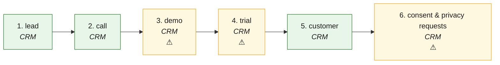

# L2C · Lead to customer — the process map from the code

<!-- GENERATED by tools/gen-process-docs.cjs from docs/process/flows.json — edit the JSON, then run the tool. -->

SAP picture: **SD pre-sales (CRM)**. One row per step: who does it · the screen · the engine function · the API route · the chit kind · the ledger entry · the test · status. A file is `repo:path` (web = this repo · api = chitbridge-api · engines = chitbridge-engines). A step marked **MISSING** has nothing in the code that does it — the evidence is in its row, nothing is invented. Generated 2026-10-12.

| # | step | module | who | screen (file · function) | engine function | API route | chit kind | ledger entry | test | status |
|---|---|---|---|---|---|---|---|---|---|---|
| 1 | lead | CRM | the shop's staff (one by hand, or the call desk's first list from a CSV) | `web:public/app/cap-crm-leads.js` `crmLeadAddOpen()` `web:public/app/cap-crm-leads.js` `crmImportOpen()` | `api:lib/crm.js` `isLead()` `api:lib/crm.js` `list()` `api:lib/memberships.js` `add()` `api:lib/crm-leads.js` `importLeads()` `api:lib/memberships.js` `addMany()` `api:lib/local-identity.js` `mintMany()` | `POST /api/crm/leads` `api:routes/crm.js` `POST /api/crm/leads/import` `api:routes/crm.js` `GET /api/crm/parties` `api:routes/crm.js` | none — a party row (added_via lead) with a lead_stage membership; the import makes the same rows as a set (≤500, phone-deduped, preview = the server's dry run) | none | `api:tests/crm-leads.test.cjs` `api:tests/crm-leads-import.test.cjs` `api:tests/crm-read.test.cjs` `web:e2e/crm.cjs` `web:e2e/walk-crm-lead-import.cjs` | ✅ |
| 2 | call | CRM | the shop's staff (the call desk) | `web:public/app/cap-crm-calls.js` `crmCallSend()` `web:public/app/cap-crm-calls.js` `crmCallScriptHTML()` `web:public/app/cap-crm-calls.js` `crmCallNext()` | `api:lib/crm-calls.js` `queue()` `api:lib/crm-calls.js` `outcome()` `api:lib/crm-followups.js` `create()` | `GET /api/crm/calls` `api:routes/crm.js` `POST /api/crm/parties/:id/outcome` `api:routes/crm.js` `POST /api/crm/followups` `api:routes/crm.js` | none — an interaction and the next follow-up | none | `api:tests/crm-calls.test.cjs` `api:tests/crm-followups.test.cjs` `api:tests/crm-interactions.test.cjs` `web:e2e/walk-x-l2c.cjs` | ✅ — W1-CRM: the call screen is the row's next level — the stage's script (CALL_SCRIPT) and Next; an outcome saved opens the row that followed. |
| 3 | demo | CRM | the shop's staff | `web:public/app/cap-crm-calls.js` `crmCallSend()` `web:public/app/cap-crm-leads.js` `crmStageGo()` | `api:lib/crm-calls.js` `outcome()` `api:lib/memberships.js` `add()` | `POST /api/crm/parties/:id/outcome` `api:routes/crm.js` `POST /api/crm/parties/:id/stage` `api:routes/crm.js` | none — outcome demo_booked moves the stage to demo and books the follow-up 'Demo' | none | `api:tests/crm-calls.test.cjs` | ⚠️ — The demo itself (held, who, what was shown) has no record beyond the follow-up row. |
| 4 | trial | CRM | the shop's staff | `web:public/app/cap-crm-leads.js` `crmStageGo()` | `api:lib/memberships.js` `add()` | `POST /api/crm/parties/:id/stage` `api:routes/crm.js` | none — a stage word only | none | `api:tests/crm-leads.test.cjs` | ⚠️ — 'trial' is one of the lead_stage groups; no outcome moves to it and nothing starts, times or ends a trial. |
| 5 | customer | CRM | the party (by trading); the shop (adds a customer) | `web:public/app/cap-crm-record.js` `web:public/app/accounts-shell.js` | `api:lib/crm.js` `isLead()` `api:lib/crm.js` `one()` | `POST /api/relationships/customers` `api:routes/relationships.js` `GET /api/crm/parties/:id` `api:routes/crm.js` `POST /api/chits/send` `api:routes/chits.js` | the first bill: txn_count > 0 ends the lead (isLead); a traded party refuses a stage move — counted for a bill SENT to the party (the recipient auto-add) and for a counter bill that NAMES them in business_json.customer (lib/crm.traded, inside the bill's transaction — FX-L2C) | none here — the bill posts under O2C step 7 | `api:tests/crm-maytrade.test.cjs` `api:tests/crm-remove-walkin.test.cjs` `api:tests/customer-by-name.test.cjs` | ✅ |
| 6 | consent & privacy requests | CRM | the shop's staff note consent (the record's Consent block); the shopper says yes/no and asks for a copy or erasure on the storefront; the owner answers a request | `web:public/app/cap-crm-privacy.js` `crmConsentHTML()` `web:public/app/cap-crm-privacy.js` `crmPrivacy()` `web:public/app/shop-privacy.js` `web:public/app/cap-crm-groups.js` `crmShareVerdict()` | `api:lib/privacy.js` `mayMessage()` `api:lib/privacy.js` `gate()` `api:lib/privacy.js` `notePref()` `api:lib/privacy.js` `logRequest()` `api:lib/privacy.js` `answerRequest()` `api:lib/privacy.js` `lawOf()` `api:lib/privacy.js` `shopper()` `api:lib/privacy.js` `facts()` | `GET /api/crm/parties/:id/contact-prefs` `api:routes/crm.js` `POST /api/crm/parties/:id/contact-prefs` `api:routes/crm.js` `GET /api/crm/privacy-requests` `api:routes/crm.js` `POST /api/crm/privacy-requests` `api:routes/crm.js` `POST /api/crm/privacy-requests/:id/answer` `api:routes/crm.js` `GET /api/privacy/facts` `api:routes/privacy.js` `GET /api/privacy/me` `api:routes/privacy.js` `POST /api/privacy/me/consent` `api:routes/privacy.js` `POST /api/privacy/me/requests` `api:routes/privacy.js` | none | none | `api:tests/privacy.test.cjs` `api:tests/consent-senders.test.cjs` `web:e2e/walk-consent.cjs` | ⚠️ — T3-P3-CONSENT (14 Oct): screens built — CRM record › Consent, #/privacy register, the storefront's Privacy sheet; every provider send asks lib/privacy.gate (consent-senders guard). Still warn: migrations b306 / b307 are drafts the owner runs (docs/compliance/OWNER-ACTIONS.md). |

## The backlog this map leaves

- **step 3 · demo** — ⚠️ — The demo itself (held, who, what was shown) has no record beyond the follow-up row.
- **step 4 · trial** — ⚠️ — 'trial' is one of the lead_stage groups; no outcome moves to it and nothing starts, times or ends a trial.
- **step 6 · consent & privacy requests** — ⚠️ — T3-P3-CONSENT (14 Oct): screens built — CRM record › Consent, #/privacy register, the storefront's Privacy sheet; every provider send asks lib/privacy.gate (consent-senders guard). Still warn: migrations b306 / b307 are drafts the owner runs (docs/compliance/OWNER-ACTIONS.md).
