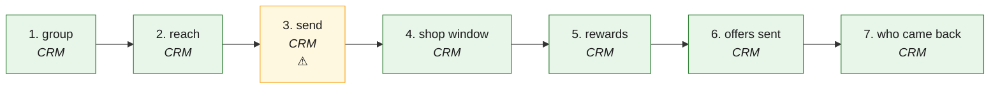

# M2R · Market to reach (T3-P2-CRM: a set of customers, their consent, one send, the shop window) — the process map from the code

<!-- GENERATED by tools/gen-process-docs.cjs from docs/process/flows.json — edit the JSON, then run the tool. -->

SAP picture: **SD / CRM marketing (campaign) — a baseline, not a spec: our set is the one segment rule + customer_list.groups, our send asks the one gate**. One row per step: who does it · the screen · the engine function · the API route · the chit kind · the ledger entry · the test · status. A file is `repo:path` (web = this repo · api = chitbridge-api · engines = chitbridge-engines). A step marked **MISSING** has nothing in the code that does it — the evidence is in its row, nothing is invented. Generated 2026-10-12.

| # | step | module | who | screen (file · function) | engine function | API route | chit kind | ledger entry | test | status |
|---|---|---|---|---|---|---|---|---|---|---|
| 1 | group | CRM | the owner or an editor names a group and places customers in it | `web:public/app/cap-crm-groups.js` `crmGroups()` `web:public/app/cap-crm-groups.js` `crmGroupSave()` | `api:lib/crm-groups.js` `overview()` `api:lib/crm-groups.js` `setGroup()` `api:lib/customer-groups.js` `segmentSql()` | `GET /api/crm/segments` `api:routes/crm.js` `POST /api/crm/groups` `api:routes/crm.js` `DELETE /api/crm/groups/:name` `api:routes/crm.js` | none — customer_list.groups[] (b205), the same value an offer's Only for stores; the four segments are SEGMENT_SQL, read | none | `api:tests/crm-groups.test.cjs` `web:e2e/walk-crm-marketing.cjs` | ✅ |
| 2 | reach | CRM | the screen asks who may be sent offers — the server's verdict per member, by code | `web:public/app/cap-crm-groups.js` `crmSendCheck()` | `api:lib/crm-groups.js` `reach()` `api:lib/privacy.js` `mayAll()` | `POST /api/crm/segments/:key/send` `api:routes/crm.js` | none — dry: nothing is sent | none | `api:tests/crm-groups.test.cjs` `web:e2e/walk-crm-marketing.cjs` | ✅ |
| 3 | send | CRM | the owner or an editor sends to the members who agreed — the one sender per member | `web:public/app/cap-crm-groups.js` `crmSendGo()` | `api:lib/crm-groups.js` `send()` `api:lib/whatsapp-out.js` `notify()` `api:lib/privacy.js` `gate()` | `POST /api/crm/segments/:key/send` `api:routes/crm.js` | none — a channel_outbound row per member (sent · refused with the sender's reason · failed) | none | `api:tests/crm-groups.test.cjs` `api:tests/consent-senders.test.cjs` | ⚠️ — Only WhatsApp is sendable, and only with WHATSAPP_TOKEN and a bound line (b123/b126); without them every member is refused in words. A set over 100 is refused before any send. |
| 4 | shop window | CRM | the owner picks the showcase template; staff share the link with a party who agreed, or with a group | `web:public/app/cap-crm-groups.js` `crmShowcase()` `web:public/app/cap-crm-groups.js` `crmShareGo()` `web:public/app/cap-showcase.js` `html()` `web:public/app/showcase-templates.js` `render()` | `api:lib/privacy.js` `gate()` | `GET /api/entities/policy` `api:routes/entities.js` `PATCH /api/entities/policy` `api:routes/entities.js` `POST /api/crm/parties/:id/interactions` `api:routes/crm.js` | none — the policy flag showcase_template; a shared link is an OUT message on the party's timeline, gated | none | `web:e2e/walk-crm-marketing.cjs` | ✅ — The share itself leaves from the shop's own phone (wa.me); the api logs it through the gate. |
| 5 | rewards | CRM | staff read a customer's points on the record (balance · worth · next · expiry · history) | `web:public/app/cap-rewards.js` `load()` `web:public/app/cap-crm-record.js` `crmRecordPaint()` | `api:lib/rewards.js` `balanceOf()` `api:lib/rewards.js` `worthOf()` `api:lib/reward-store.js` `balance()` | `GET /api/relationships/customers/:id/rewards` `api:routes/relationships.js` | none — the reward ledger, folded by the engine | none | `web:e2e/walk-crm-marketing.cjs` | ✅ |
| 6 | offers sent | CRM | the owner reads every offer message of a send - sent or not, to whom, why not, on which consent (Marketing face, MKT first slice) | `web:public/app/cap-marketing.js` `mktSent()` | `api:lib/channels.js` `listOutbound()` `api:lib/whatsapp-out.js` `logRefused()` `api:lib/marketing-results.js` `reasonCodeOf()` | `GET /api/channels/outbound` `api:routes/channels.js` | none - channel_outbound receipts with party_id, purpose, send_ref, basis (b776); the group's refusals are receipts too | none | `api:tests/marketing-outbound.test.cjs` `api:tests/marketing-truth.realstack.cjs` `web:e2e/walk-marketing.cjs` | ✅ — Before b776 runs the list says it arrives after the next update. Only WhatsApp, as step 3. |
| 7 | who came back | CRM | the owner sees which customers who were sent an offer then bought, and the money they spent (Marketing face) | `web:public/app/cap-marketing.js` `mktResults()` `web:public/app/cap-marketing.js` `mktWinbackHTML()` | `api:lib/marketing-results.js` `cameBack()` `api:lib/select.js` `rows()` `api:lib/measure.js` `measure()` | `GET /api/marketing/came-back` `api:routes/marketing.js` | none - read from the shop's own bills (counter bills naming the customer included), only for offers that were SENT | none - the Ledger holds credit bills only, so it is not the source | `api:tests/marketing-results.test.cjs` `api:tests/marketing-truth.realstack.cjs` `web:e2e/walk-marketing.cjs` | ✅ — The days are the shop's setting came_back_days (default 14). Live, a 0 stays until an offers template is approved on the number - the screen says so. |

## The backlog this map leaves

- **step 3 · send** — ⚠️ — Only WhatsApp is sendable, and only with WHATSAPP_TOKEN and a bound line (b123/b126); without them every member is refused in words. A set over 100 is refused before any send.
