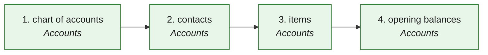

# MVI · Move in (from Xero / QuickBooks) — the process map from the code

<!-- GENERATED by tools/gen-process-docs.cjs from docs/process/flows.json — edit the JSON, then run the tool. -->

SAP picture: **FI (conversion: opening balances, master data)**. One row per step: who does it · the screen · the engine function · the API route · the chit kind · the ledger entry · the test · status. A file is `repo:path` (web = this repo · api = chitbridge-api · engines = chitbridge-engines). A step marked **MISSING** has nothing in the code that does it — the evidence is in its row, nothing is invented. Generated 2026-10-12.

| # | step | module | who | screen (file · function) | engine function | API route | chit kind | ledger entry | test | status |
|---|---|---|---|---|---|---|---|---|---|---|
| 1 | chart of accounts | Accounts | the owner, or the practice that keeps the books | `web:public/app/cap-move-in.js` `miView()` `web:public/app/cap-move-in.js` `miRender()` | `api:lib/move-in.js` `guess()` `api:lib/move-in.js` `plan()` `api:lib/move-in.js` `apply()` `api:lib/books.js` `addAccount()` `engines:src/reg-au.js` `groupFor()` `engines:src/reg-au.js` `roleFor()` | `POST /api/books/move-in/preflight` `api:routes/books.js` `POST /api/books/move-in/preview` `api:routes/books.js` `POST /api/books/move-in/import` `api:routes/books.js` `POST /api/books/accounts` `api:routes/books.js` | none | a ledger per account under its group (the system's code; theirs kept as source_code, b300); a control account merges onto the role ledger | `api:tests/move-in.test.cjs` `engines:tests/reg-au.test.js` `web:e2e/walk-move-in.cjs` | ✅ — The columns are the export's recall (IM0), guessed and confirmed, never assumed. source_code needs migration b300 (a file); before it the trial balance matches on names. |
| 2 | contacts | Accounts | the owner, or the practice | `web:public/app/cap-move-in.js` `miView()` | `api:lib/move-in.js` `plan()` `api:lib/move-in.js` `apply()` `api:lib/local-identity.js` `mint()` `api:lib/party-fields.js` `patch()` `api:lib/party-fields.js` `checkTaxId()` `engines:src/reg-au.js` `abnCheck()` | `POST /api/books/move-in/preflight` `api:routes/books.js` `POST /api/books/move-in/preview` `api:routes/books.js` `POST /api/books/move-in/import` `api:routes/books.js` | none | none — a party on the customer / supplier list (party_no from the one series; ABN as a party_tax_id) | `api:tests/move-in.test.cjs` `engines:tests/reg-au.test.js` `web:e2e/walk-move-in.cjs` | ✅ — Dedupe: ABN, then phone (as L3's lead import), then name. A bad ABN is skipped with reg-au's sentence. Writes per party go through party-fields.patch (the one writer). |
| 3 | items | Accounts | the owner, or the practice | `web:public/app/cap-move-in.js` `miView()` | `api:lib/move-in.js` `plan()` `api:lib/catalogue-write.js` `writeItems()` `api:lib/item-cost.js` `setCost()` `engines:src/reg-au.js` `supplyKindFor()` | `POST /api/books/move-in/preflight` `api:routes/books.js` `POST /api/books/move-in/preview` `api:routes/books.js` `POST /api/books/move-in/import` `api:routes/books.js` | none | none — a product with price and gst_rate (their tax code → the pack's supply kind → the rate) | `api:tests/move-in.test.cjs` `engines:tests/reg-au.test.js` `web:e2e/walk-move-in.cjs` | ✅ — A code already in the catalogue is skipped (a move-in never overwrites prices). Stock on hand is not read in phase 1. |
| 4 | opening balances | Accounts | the owner, or the practice | `web:public/app/cap-move-in.js` `miImport()` `web:public/app/cap-move-in.js` `miDoneHTML()` | `api:lib/move-in.js` `plan()` `api:lib/books.js` `postOpening()` `engines:src/posting.js` `post()` | `POST /api/books/move-in/preflight` `api:routes/books.js` `POST /api/books/move-in/preview` `api:routes/books.js` `POST /api/books/move-in/import` `api:routes/books.js` `POST /api/books/opening` `api:routes/books.js` | none | ONE opening entry (period 0) per file: the trial balance (the customers / suppliers control rows left out), then the open invoices and bills bill-wise on 1300 / 2100 with party, bill and due date; the difference on Suspense 2900 | `api:tests/move-in.test.cjs` `engines:tests/reg-au.test.js` `web:e2e/walk-move-in.cjs` | ✅ — An unbalanced trial balance is refused with the sentence; nothing posts. The same file twice posts nothing (client_ref movein:<kind>:<as_at>). |

## The backlog this map leaves

Every step is built and tested.
