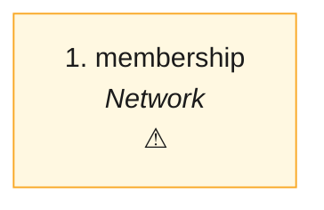

# NET · Join a network (a store and a brand: ask, invite, approve, pause, leave) — the process map from the code

<!-- GENERATED by tools/gen-process-docs.cjs from docs/process/flows.json — edit the JSON, then run the tool. -->

SAP picture: **SD (partner determination) · no SAP equivalent for the two-sided consent**. One row per step: who does it · the screen · the engine function · the API route · the chit kind · the ledger entry · the test · status. A file is `repo:path` (web = this repo · api = chitbridge-api · engines = chitbridge-engines). A step marked **MISSING** has nothing in the code that does it — the evidence is in its row, nothing is invented. Generated 2026-10-12.

| # | step | module | who | screen (file · function) | engine function | API route | chit kind | ledger entry | test | status |
|---|---|---|---|---|---|---|---|---|---|---|
| 1 | membership | Network | a store (asks, accepts an invitation, leaves) and the brand (invites, approves, pauses, resumes, removes) — the server says who may, with the sentence | `web:public/app/network-app.js` `load()` | `api:lib/network-membership.js` `standing()` `api:lib/network-membership.js` `edgesOf()` `api:lib/network-membership.js` `mayOf()` `api:src/services/network.js` `mayAct()` | `GET /api/network-offers` `api:routes/network-offers.js` `POST /api/network/connections` `api:src/routes/network.js` `POST /api/network/connections/:id/approve` `api:src/routes/network.js` `POST /api/network/connections/:id/decline` `api:src/routes/network.js` | none — a commercial edge (cb_edge, b261: one per brand) both businesses hold | none | `api:tests/network-member-view.test.cjs` `api:tests/network-authority.test.cjs` `web:e2e/network-guard.cjs` | ⚠️ — NET-SRV1 (2026-10-14): the server answers every row's may/why from the one rule table (mayAct) and names the brand's and its root's bridge id; a store sees the brand it asked without selling for it yet. The screen that shows the actions waits for its design — network-app.js paints the standing word only. |

## The backlog this map leaves

- **step 1 · membership** — ⚠️ — NET-SRV1 (2026-10-14): the server answers every row's may/why from the one rule table (mayAct) and names the brand's and its root's bridge id; a store sees the brand it asked without selling for it yet. The screen that shows the actions waits for its design — network-app.js paints the standing word only.
