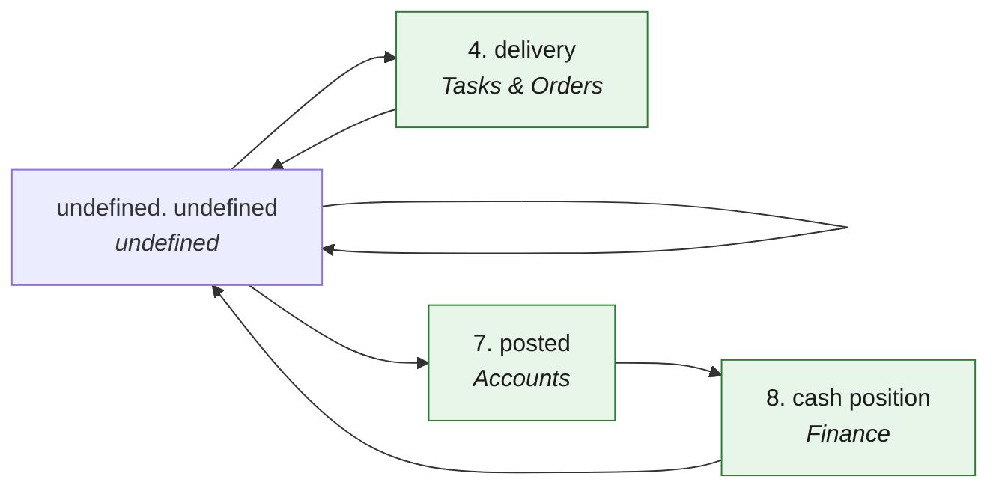

# O2C · Order to cash — the process map from the code

<!-- GENERATED by tools/gen-process-docs.cjs from docs/process/flows.json — edit the JSON, then run the tool. -->

SAP picture: **SD → FI-AR**. One row per step: who does it · the screen · the engine function · the API route · the chit kind · the ledger entry · the test · status. A file is `repo:path` (web = this repo · api = chitbridge-api · engines = chitbridge-engines). A step marked **MISSING** has nothing in the code that does it — the evidence is in its row, nothing is invented. Generated 2026-10-12.

| # | step | module | who | screen (file · function) | engine function | API route | chit kind | ledger entry | test | status |
|---|---|---|---|---|---|---|---|---|---|---|
|  |  |  |  | — | — | — |  |  | — | undefined |
|  |  |  |  | — | — | — |  |  | — | undefined |
|  |  |  |  | — | — | — |  |  | — | undefined |
| 4 | delivery | Tasks & Orders | the seller's staff | `web:public/app/cap-chit2.js` `web:public/app/cap-worklist.js` `wlAssignSave()` `web:public/app/cap-tasks.js` `tkMove()` `web:public/app/cap-tasks.js` `tkAssignLine()` `web:public/app/cap-tasks.js` `tkDeliver()` | `api:lib/deliverline.js` `record()` `api:lib/deliverline.js` `progress()` `api:lib/stock-from-chit.js` `postFor()` `api:lib/stock-store.js` `post()` | `POST /api/chits/:chit_id/deliver-lines` `api:routes/chits.js` `PUT /api/chits/:chit_id/status` `api:routes/chits.js` `POST /api/chits/:chit_id/assign-lines` `api:routes/chits.js` `PUT /api/actors/assign/:chit_id` `api:routes/actors.js` | the order's lines marked delivered; status → completed | none — a stock movement OUT (perpetual, weighted average) | `api:tests/line-complete.test.cjs` `api:tests/stock-cycle.test.js` `web:e2e/walk-tasks.cjs` | ✅ |
|  |  |  |  | — | — | — |  |  | — | undefined |
|  |  |  |  | — | — | — |  |  | — | undefined |
|  |  |  |  | — | — | — |  |  | — | undefined |
| 7 | posted | Accounts | the system (the hook after a chit; the nightly for walk-in days) | `web:public/app/cap-books.js` `bkEntryHead()` | `api:lib/books-hooks.js` `postChit()` `api:lib/books-hooks.js` `classify()` `api:lib/books.js` `postEntry()` `engines:src/posting.js` `sale_bill()` `engines:src/posting.js` `walkin_day()` | `POST /api/books/events` `api:routes/books.js` `GET /api/books/daybook` `api:routes/books.js` | bill → one entry (source_ref bill:<chit_id>) | sale_bill · Dr 1300 Customers (unpaid) / Dr 1400·1500·1510·1520 (paid) · Cr 4000 Sales · Cr 2200/2201/2202 Output CGST/SGST/IGST · 6900 Round off. walkin_day: the same per counter per day, no party | `api:tests/books-hooks.test.cjs` `api:tests/books-auto-post.test.cjs` `api:tests/books-post.test.cjs` `api:tests/books-day-bills.test.cjs` `engines:tests/posting.test.js` `engines:tests/golden-books.test.js` | ✅ |
| 8 | cash position | Finance | the owner (reads; Finance suggests, nothing posts) | `web:public/app/cap-finance-cash.js` `fcMount()` `web:public/app/cap-finance-cash.js` `fcChart()` | `api:lib/books-cashflow.js` `project()` `api:lib/books-cashflow.js` `read()` `api:lib/receivables.js` `outstanding()` `engines:src/receivables.js` `propose()` `engines:src/receivables.js` `pdcReminders()` `engines:src/ledger.js` `balanceAsAt()` | `GET /api/books/cashflow` `api:routes/books.js` `GET /api/books/cheques` `api:routes/books.js` | none — a read of the open bills, the promised dates (CRM follow-ups) and the cheques in hand behind each day | none — reads the cash / bank role ledgers as at today; the first day below zero is said in words | `api:tests/books-cashflow.test.cjs` `web:e2e/walk-finance-cash.cjs` `engines:tests/receivables.test.js` | ✅ |
|  |  |  |  | — | — | — |  |  | — | undefined |
|  |  |  |  | — | — | — |  |  | — | undefined |
|  |  |  |  | — | — | — |  |  | — | undefined |
|  |  |  |  | — | — | — |  |  | — | undefined |
|  |  |  |  | — | — | — |  |  | — | undefined |
|  |  |  |  | — | — | — |  |  | — | undefined |

## The backlog this map leaves

- **step undefined · undefined** — undefined — undefined
- **step undefined · undefined** — undefined — undefined
- **step undefined · undefined** — undefined — undefined
- **step undefined · undefined** — undefined — undefined
- **step undefined · undefined** — undefined — undefined
- **step undefined · undefined** — undefined — undefined
- **step undefined · undefined** — undefined — undefined
- **step undefined · undefined** — undefined — undefined
- **step undefined · undefined** — undefined — undefined
- **step undefined · undefined** — undefined — undefined
- **step undefined · undefined** — undefined — undefined
- **step undefined · undefined** — undefined — undefined
