# O2C · Order to cash — the process map from the code

<!-- GENERATED by tools/gen-process-docs.cjs from docs/process/flows.json — edit the JSON, then run the tool. -->

SAP picture: **SD → FI-AR**. One row per step: who does it · the screen · the engine function · the API route · the chit kind · the ledger entry · the test · status. A file is `repo:path` (web = this repo · api = chitbridge-api · engines = chitbridge-engines). A step marked **MISSING** has nothing in the code that does it — the evidence is in its row, nothing is invented. Generated 2026-10-12.

```mermaid
flowchart LR
  S1["1. enquiry<br/><i>Network</i><br/>⚠"]
  S2["2. quote<br/><i>Tasks & Orders</i><br/>MISSING"]
  S3["3. order<br/><i>Tasks & Orders</i>"]
  S4["4. delivery<br/><i>Tasks & Orders</i>"]
  S5["5. invoice<br/><i>Till</i>"]
  S6["6. receipt<br/><i>Finance</i>"]
  S7["7. posted<br/><i>Accounts</i>"]
  S8["8. cash position<br/><i>Finance</i>"]
  S9["9. repeat supply<br/><i>Finance</i>"]
  S1 --> S2 --> S3 --> S4 --> S5 --> S6 --> S7 --> S8 --> S9
  classDef ok fill:#e8f5e9,stroke:#2e7d32,color:#1b1b1b
  classDef warn fill:#fff8e1,stroke:#f9a825,color:#1b1b1b
  classDef missing fill:#fafafa,stroke:#9e9e9e,stroke-dasharray:5 5,color:#616161
  class S3,S4,S5,S6,S7,S8,S9 ok
  class S1 warn
  class S2 missing
```

| # | step | module | who | screen (file · function) | engine function | API route | chit kind | ledger entry | test | status |
|---|---|---|---|---|---|---|---|---|---|---|
| 1 | enquiry | Network | a buyer the catalogue was delivered to | `web:public/app.html` `enquirySend()` | — | `POST /api/catalogue/enquiry/:item_id` `api:routes/catalogue.js` `GET /api/catalogue/enquiry/:item_id` `api:routes/catalogue.js` `GET /api/catalogue/enquiry` `api:routes/catalogue.js` | none — a message thread on the item | none | — | ⚠️ — No engine function and no test: the route writes the thread itself (RLS scopes the read). |
| 2 | quote | Tasks & Orders | the seller | — | — | — | none | none | — | MISSING — Nothing stores a priced offer to a named party before an order. Evidence: api lib/instruments.js names the stage ('Catalogue, quote & terms') and lib/beckn-map.js maps a Beckn quote, but no route, chit kind or screen raises one. |
| 3 | order | Tasks & Orders | the buyer (storefront, or the shop's own app) | `web:public/shop.html` `orderStart()` `web:public/shop.html` `_orderPost()` `web:public/app.html` `sendChit()` `web:public/app/cap-tasks.js` `tkList()` `web:public/app/cap-tasks.js` `tkOpen()` | `api:lib/mint.js` `order()` `api:lib/workflow.js` `kindOf()` `engines:src/workflow.js` `stageOf()` `engines:src/orders.js` `kindOf()` | `POST /api/catalogue/:bridge_id/order/confirm` `api:routes/catalogue.js` `POST /api/chits/send` `api:routes/chits.js` `GET /api/work/list` `api:routes/work.js` `GET /api/work/:chit_id` `api:routes/work.js` | order (workflow kind order_in on the seller's copy) | none — an order moves nothing (lib/stock-from-chit.js) | `api:tests/orders.test.js` `api:tests/t2e-orders.test.cjs` `api:tests/work-rows.test.cjs` `engines:tests/workflow.test.js` `web:tests/t2e-cart.test.cjs` `web:e2e/walk-tasks.cjs` | ✅ |
| 4 | delivery | Tasks & Orders | the seller's staff | `web:public/app/cap-chit2.js` `web:public/app/cap-worklist.js` `wlAssignSave()` `web:public/app/cap-tasks.js` `tkMove()` `web:public/app/cap-tasks.js` `tkAssignLine()` `web:public/app/cap-tasks.js` `tkDeliver()` | `api:lib/deliverline.js` `record()` `api:lib/deliverline.js` `progress()` `api:lib/stock-from-chit.js` `postFor()` `api:lib/stock-store.js` `post()` | `POST /api/chits/:chit_id/deliver-lines` `api:routes/chits.js` `PUT /api/chits/:chit_id/status` `api:routes/chits.js` `POST /api/chits/:chit_id/assign-lines` `api:routes/chits.js` `PUT /api/actors/assign/:chit_id` `api:routes/actors.js` | the order's lines marked delivered; status → completed | none — a stock movement OUT (perpetual, weighted average) | `api:tests/line-complete.test.cjs` `api:tests/stock-cycle.test.js` `web:e2e/walk-tasks.cjs` | ✅ |
| 5 | invoice | Till | the seller (the counter bill IS the invoice) | `web:public/till.html` `fetchBy()` `web:public/bill-print.html` `web:public/app/chit-sheet.js` `mount()` `web:public/app/cap-crm-chits.js` `chitPage()` | `api:lib/tax-lines.js` `invoiceFor()` `api:lib/tax-lines.js` `walkIn()` `api:lib/docnumber.js` `engines:src/einvoice.js` `irnPayload()` | `POST /api/chits/send` `api:routes/chits.js` `POST /api/invoice/build` `api:routes/invoice.js` `GET /api/tax/invoice/:chit_id` `api:routes/tax.js` | bill (business_json.invoice frozen by invoiceFor) | none until posted (step 7) | `api:tests/tax-lines.test.js` `api:tests/walk-in-buyer.test.cjs` `api:tests/two-sided-bill.test.cjs` `api:tests/bill-checks.test.js` `engines:tests/einvoice.test.js` `web:e2e/walk-bill.cjs` | ✅ |
| 6 | receipt | Finance | the owner or a person with the books (Receive) | `web:public/app/cap-books.js` `payOpen()` `web:public/app/cap-finance.js` `finMount()` `web:public/app.html` `chitPaySubmit()` | `api:lib/books.js` `recordPayment()` `api:lib/receivables.js` `propose()` `engines:src/receivables.js` `propose()` `api:lib/books-hooks.js` `recordChitPayment()` | `POST /api/books/payments/preview` `api:routes/books.js` `POST /api/books/payments` `api:routes/books.js` `POST /api/chits/:chit_id/payment` `api:routes/chits.js` | the payment is recorded on the bill | payment_received · Dr 1400 Cash / 1500 Bank / 1510 UPI / 1520 Card · Cr 1300 Customers (a cheque only when cleared) | `api:tests/books-payments.test.cjs` `api:tests/books-collections.test.cjs` `engines:tests/receivables.test.js` `web:e2e/cb-accounts.cjs` `web:e2e/walk-finance.cjs` | ✅ |
| 7 | posted | Accounts | the system (the hook after a chit; the nightly for walk-in days) | `web:public/app/cap-books.js` `bkEntryHead()` | `api:lib/books-hooks.js` `postChit()` `api:lib/books-hooks.js` `classify()` `api:lib/books.js` `postEntry()` `engines:src/posting.js` `sale_bill()` `engines:src/posting.js` `walkin_day()` | `POST /api/books/events` `api:routes/books.js` `GET /api/books/daybook` `api:routes/books.js` | bill → one entry (source_ref bill:<chit_id>) | sale_bill · Dr 1300 Customers (unpaid) / Dr 1400·1500·1510·1520 (paid) · Cr 4000 Sales · Cr 2200/2201/2202 Output CGST/SGST/IGST · 6900 Round off. walkin_day: the same per counter per day, no party | `api:tests/books-hooks.test.cjs` `api:tests/books-auto-post.test.cjs` `api:tests/books-post.test.cjs` `api:tests/books-day-bills.test.cjs` `engines:tests/posting.test.js` `engines:tests/golden-books.test.js` | ✅ |
| 8 | cash position | Finance | the owner (reads; Finance suggests, nothing posts) | `web:public/app/cap-finance-cash.js` `fcMount()` `web:public/app/cap-finance-cash.js` `fcChart()` | `api:lib/books-cashflow.js` `project()` `api:lib/books-cashflow.js` `read()` `api:lib/receivables.js` `outstanding()` `engines:src/receivables.js` `propose()` `engines:src/receivables.js` `pdcReminders()` `engines:src/ledger.js` `balanceAsAt()` | `GET /api/books/cashflow` `api:routes/books.js` `GET /api/books/cheques` `api:routes/books.js` | none — a read of the open bills, the promised dates (CRM follow-ups) and the cheques in hand behind each day | none — reads the cash / bank role ledgers as at today; the first day below zero is said in words | `api:tests/books-cashflow.test.cjs` `web:e2e/walk-finance-cash.cjs` `engines:tests/receivables.test.js` | ✅ |
| 9 | repeat supply | Finance | the seller proposes it from a sent invoice; the customer accepts, counters or declines; each run mints a normal invoice | `web:public/app/cap-repeat.js` `rpStart()` `web:public/app/cap-repeat.js` `rpMount()` `web:public/app/cap-repeat.js` `rpPanel()` `web:public/app/chit-sheet.js` `actionsFor()` | `api:lib/repeat-supply.js` `create()` `api:lib/repeat-supply.js` `may()` `api:lib/repeat-supply.js` `sweep()` `api:lib/books-recurring.js` `nextAfter()` `api:lib/autoraise.js` `sendAs()` | `GET /api/repeat` `api:routes/repeat-supply.js` `POST /api/repeat` `api:routes/repeat-supply.js` `POST /api/repeat/:id/accept` `api:routes/repeat-supply.js` `POST /api/repeat/:id/counter` `api:routes/repeat-supply.js` `POST /api/repeat/:id/skip` `api:routes/repeat-supply.js` `POST /api/repeat/:id/run` `api:routes/repeat-supply.js` | subscription (the agreement, both parties hold it) → one invoice per run, client_ref rep:<agreement>:<date> | each run posts as any sent invoice (lib/books-hooks afterChit); the agreement itself posts nothing | `api:tests/repeat-supply.test.cjs` `web:e2e/walk-repeat-supply.cjs` | ✅ — RI1 (2026-10-12): better than a recurring invoice — the customer agrees first (accept · counter · decline), can skip a run with a reason, and pausing or ending is visible to both. Table repeat_supply (b303, DRAFT — renumbered in INT2; IM1 holds b302). |

## The backlog this map leaves

- **step 1 · enquiry** — ⚠️ — No engine function and no test: the route writes the thread itself (RLS scopes the read).
- **step 2 · quote** — MISSING — Nothing stores a priced offer to a named party before an order. Evidence: api lib/instruments.js names the stage ('Catalogue, quote & terms') and lib/beckn-map.js maps a Beckn quote, but no route, chit kind or screen raises one.
