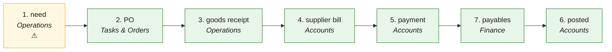

# P2P · Procure to pay — the process map from the code

<!-- GENERATED by tools/gen-process-docs.cjs from docs/process/flows.json — edit the JSON, then run the tool. -->

SAP picture: **MM → FI-AP**. One row per step: who does it · the screen · the engine function · the API route · the chit kind · the ledger entry · the test · status. A file is `repo:path` (web = this repo · api = chitbridge-api · engines = chitbridge-engines). A step marked **MISSING** has nothing in the code that does it — the evidence is in its row, nothing is invented. Generated 2026-10-12.

| # | step | module | who | screen (file · function) | engine function | API route | chit kind | ledger entry | test | status |
|---|---|---|---|---|---|---|---|---|---|---|
| 1 | need | Operations | the shop's staff | `web:public/app/cap-supplies.js` `supAdd()` `web:public/app/cap-intake.js` | `api:lib/supply-store.js` `ensure()` `api:lib/capture.js` `raisePayload()` | `POST /api/supplies` `api:routes/supplies.js` `POST /api/capture/:id/raise` `api:routes/capture.js` | none yet — a supply row, or a captured message about to become a chit | none | `api:tests/local-supplier.test.js` | ⚠️ — No test exercises lib/supply-store.js or routes/supplies.js by name. |
| 2 | PO | Tasks & Orders | the shop (as buyer) | `web:public/app.html` `sendChit()` | `api:lib/mint.js` `order()` `api:lib/workflow.js` `kindOf()` | `POST /api/chits/send` `api:routes/chits.js` `GET /api/work/list` `api:routes/work.js` | order (workflow kind order_out on the buyer's copy) | none | `api:tests/work-rows.test.cjs` `api:tests/t2e-orders.test.cjs` `engines:tests/workflow.test.js` | ✅ |
| 3 | goods receipt | Operations | the shop's staff (goods-in, with what the goods are FOR) | `web:public/app/cap-chit2.js` `web:public/till.html` `stockWrite()` | `api:lib/deliverline.js` `record()` `api:lib/bill-use.js` `set()` `api:lib/stock-from-chit.js` `postFor()` `api:lib/stock-store.js` `post()` | `POST /api/chits/:chit_id/deliver-lines` `api:routes/chits.js` `POST /api/till/stock` `api:routes/till.js` | the supplier's bill or order, lines received | none — a stock movement IN at landed cost | `api:tests/goods-in-accepts.test.cjs` `api:tests/bill-use.test.cjs` `api:tests/stock-cycle.test.js` | ✅ |
| 4 | supplier bill | Accounts | the supplier (delivered over CTP or captured) or the shop (a supply bought) | `web:public/app/cap-supplies.js` `supAdd()` `web:public/app.html` `sendChit()` | `api:lib/books-hooks.js` `classify()` `api:lib/books-hooks.js` `useEvents()` `api:lib/supply-store.js` `purchase()` `engines:src/posting.js` `purchase_bill()` | `POST /api/ctp/deliver` `api:routes/ctp.js` `POST /api/supplies/purchase` `api:routes/supplies.js` `POST /api/chits/:chit_id/books-request` `api:routes/chits.js` | bill (received copy, side buy) | purchase_bill · Dr 5000 Purchases (resale) / an asset 10xx / an expense 6xxx (by `use`) · Dr 2210/2211/2212 Input CGST/SGST/IGST · Cr 2100 Suppliers · reverse charge Cr 2204/2205/2206 | `api:tests/books-hooks.test.cjs` `api:tests/books-rcm.test.cjs` `api:tests/two-sided-books.test.cjs` `engines:tests/rcm.test.js` | ✅ |
| 5 | payment | Accounts | the owner or a person with the books (Pay) | `web:public/app/cap-books.js` `payOpen()` `web:public/app/rail-advice.js` | `api:lib/books.js` `recordPayment()` `engines:src/posting.js` `payment_made()` `engines:src/ledger.js` `AGE_PAYABLE()` | `POST /api/books/payments` `api:routes/books.js` `GET /api/books/payments/:id/advice` `api:routes/books.js` `POST /api/books/cheques/:id/status` `api:routes/books.js` | the payment advice goes to the supplier as a chit (rail-advice.js → /api/chits/send) | payment_made · Dr 2100 Suppliers · Cr 1400 Cash / 1500 Bank (a cheque only when cleared) | `api:tests/books-payments.test.cjs` `web:tests/advice-retry.test.cjs` | ✅ |
| 7 | payables | Finance | the owner (reads; Pay and the discount are the owner's own presses — Finance suggests, nothing posts by itself) | `web:public/app/cap-finance-pay.js` `fpMount()` `web:public/app/cap-finance-pay.js` `fpPay()` `web:public/app/cap-books.js` `payOpen()` `web:public/app/cap-books.js` `payDiscRecord()` | `api:lib/books-payables.js` `view()` `api:lib/books-payables.js` `read()` `api:lib/books-cashflow.js` `datedSide()` `engines:src/receivables.js` `msmeFlags()` `engines:src/receivables.js` `earlyDiscount()` `api:lib/books.js` `postEntry()` | `GET /api/books/dues` `api:routes/books.js` `POST /api/books/payments` `api:routes/books.js` `POST /api/books/entries` `api:routes/books.js` | the supplier's bill (side buy) → the payment, its advice chit (step 5) | none to read; the discount (owner-pressed) is a journal: Dr 2100 Suppliers (against the bill) · Cr 4230 Discount received. The GST credit note waits for the supplier's and the owner's confirm | `api:tests/books-payables.test.cjs` `web:e2e/walk-finance-payables.cjs` | ✅ — F4: supplier bill → payment — what we owe, aged 0–30/31–45/46–60/60+, MSME day 45 (India, Income-tax s.43B(h)), the supplier's early-pay offer. The total is F3's outgoing (one calculation). |
| 6 | posted | Accounts | the system (the hook after the bill is accepted) | `web:public/app/cap-books.js` `bkLgEntry()` | `api:lib/books-hooks.js` `postChit()` `api:lib/books.js` `postEntry()` `engines:src/posting.js` `purchase_bill()` | `GET /api/books/daybook` `api:routes/books.js` `GET /api/books/ledger/:account` `api:routes/books.js` `GET /api/books/party/:id/statement` `api:routes/books.js` | bill → one entry (source_ref chit:<chit_id>); what cannot post waits in books_outbox | as step 4; the supplier's statement reads 2100 by party | `api:tests/books-post.test.cjs` `api:tests/books-hooks.test.cjs` `engines:tests/golden-books.test.js` | ✅ |

## The backlog this map leaves

- **step 1 · need** — ⚠️ — No test exercises lib/supply-store.js or routes/supplies.js by name.
