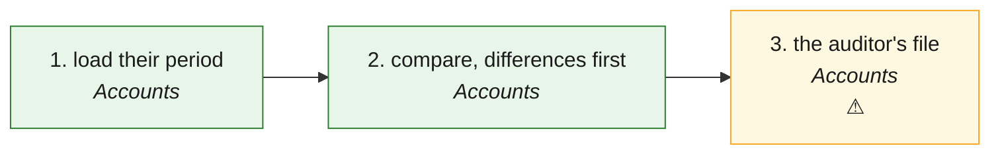

# PRN · Parallel run (their Tally / Xero period beside ours) — the process map from the code

<!-- GENERATED by tools/gen-process-docs.cjs from docs/process/flows.json — edit the JSON, then run the tool. -->

SAP picture: **FI (audit: parallel run, reconciliation of statements)**. One row per step: who does it · the screen · the engine function · the API route · the chit kind · the ledger entry · the test · status. A file is `repo:path` (web = this repo · api = chitbridge-api · engines = chitbridge-engines). A step marked **MISSING** has nothing in the code that does it — the evidence is in its row, nothing is invented. Generated 2026-10-12.

| # | step | module | who | screen (file · function) | engine function | API route | chit kind | ledger entry | test | status |
|---|---|---|---|---|---|---|---|---|---|---|
| 1 | load their period | Accounts | the owner, or the shop's auditor (whole entity, may see money) | `web:public/app/cap-compare.js` `cmpLoadOpen()` `web:public/app/cap-compare.js` `cmpKeep()` | `api:lib/parallel-run.js` `preflight()` `api:lib/parallel-run.js` `read()` `api:lib/move-in.js` `guess()` `api:lib/books-store.js` `insertComparePart()` | `POST /api/books/compare/preflight` `api:routes/books.js` `POST /api/books/compare/snapshots` `api:routes/books.js` | none | none (a snapshot is never posted) | `api:tests/parallel-run.test.cjs` `web:e2e/walk-compare.cjs` | ✅ — Insert-only: a part a snapshot already has is refused (409). Before b309 runs, Load is greyed with the sentence. |
| 2 | compare, differences first | Accounts | the owner, or the shop's auditor | `web:public/app/cap-compare.js` `cmpView()` `web:public/app/cap-compare.js` `cmpPaintList()` `web:public/app/cap-compare.js` `cmpNext()` | `api:lib/parallel-run.js` `compare()` `api:lib/books.js` `trialBalance()` `api:lib/books.js` `profitAndLoss()` `api:lib/books.js` `balanceSheet()` `api:lib/books-period.js` `taxReturn()` `api:lib/tax-lines.js` `gstr3b()` | `GET /api/books/compare` `api:routes/books.js` `GET /api/books/compare/:id` `api:routes/books.js` | read (the chit behind an entry opens) | read | `api:tests/parallel-run.test.cjs` `web:e2e/walk-compare.cjs` | ✅ — Why is said where we can tell: a rounding rule, a bill on the rail they keyed later, an entry only one side has, a mapping gap. Tally XML shapes are recall, proven on fixtures. |
| 3 | the auditor's file | Accounts | the owner, or the shop's auditor | `web:public/app/cap-compare.js` `cmpCsv()` | `api:lib/parallel-run.js` `csv()` | `GET /api/books/compare/:id/csv` `api:routes/books.js` | none | read | `api:tests/parallel-run.test.cjs` | ⚠️ — CSV from the server; the PDF is the browser's print of the page (no PDF library added). |

## The backlog this map leaves

- **step 3 · the auditor's file** — ⚠️ — CSV from the server; the PDF is the browser's print of the page (no PDF library added).
