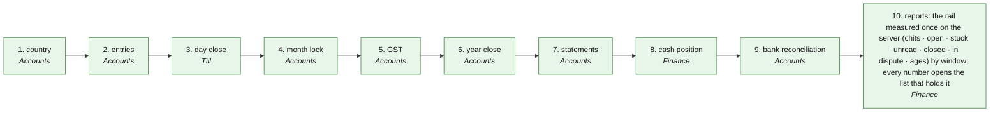

# R2R · Record to report — the process map from the code

<!-- GENERATED by tools/gen-process-docs.cjs from docs/process/flows.json — edit the JSON, then run the tool. -->

SAP picture: **FI-GL**. One row per step: who does it · the screen · the engine function · the API route · the chit kind · the ledger entry · the test · status. A file is `repo:path` (web = this repo · api = chitbridge-api · engines = chitbridge-engines). A step marked **MISSING** has nothing in the code that does it — the evidence is in its row, nothing is invented. Generated 2026-10-12.

| # | step | module | who | screen (file · function) | engine function | API route | chit kind | ledger entry | test | status |
|---|---|---|---|---|---|---|---|---|---|---|
| 1 | country | Accounts | the owner, after registration and before the books open | `web:public/app/register-form.js` `renderRegister()` `web:public/app/register-form.js` `doRegister()` `web:public/app/cap-country.js` `renderCountrySetup()` `web:public/settings.html` `paint()` `web:public/app/cap-country.js` `mount()` `web:public/app/cap-shop.js` `mount()` `web:public/country-lab.html` `paintRows()` `web:public/app/cap-country.js` `csuReadyHTML()` `web:public/country-lab.html` `paintReady()` `web:public/app/country-ready.js` `view()` | `api:lib/country-setup.js` `gate()` `engines:src/regulation.js` `status()` `engines:src/tax.js` `determine()` | `GET /api/governance/country-setup` `api:routes/governance.js` `PUT /api/governance/country-setup` `api:routes/governance.js` | none | none — the pack the chart, the year and the tax heads are read from | `web:e2e/walk-country.cjs` `web:e2e/walk-settings.cjs` `web:e2e/walk-country-lab.cjs` `api:tests/country-setup.test.cjs` | ✅ — FX-UX2 (2026-10-14): the door to this step is the register form (app/register-form.js) — app.html #/register and CB Settings › New shop (settings.html#/new, the sign-in window's New shop? Register) paint the same form; from CB Settings a verified shop lands on Home. SET1: the same step and the shop's own particulars (GSTIN · address · state · PIN — what the invoice party reads) are CB Settings (settings.html), never the workshop. CS1: the constitution (country · currency · FY · tax registration) is set once; a country with no pack is said in the server's sentence. CL1 · CL2: the Country lab shows what REGISTERING in another country would look like, read from the packs — a shop never changes country once it has a product or a transaction (DECISIONS 13 Oct). CS2 (2026-10-13): the country may be CORRECTED until the shop holds a product or a transaction (api country-setup.isConstituted) — currency · FY · scheme · time zone · chart re-derived from the new pack in one transaction; after that Country and Money are greyed with the reason and the server refuses (409). The picker = the server's countries[] (the registered packs); a multi-zone pack asks the zone, the device's preselected. FX-AU1 (2026-10-14): registration STORES the guess the panel showed (country · money · zone, the server naming its source) in the write that creates the shop; an IN→AU correction re-lays the year by its dates and the chart shows only the new pack's ledgers. CL3: both screens show "Where ChitBridge is for <country>" — per product area ✅ · ⚠️ · ❌ · —, read from public/data/country-ready.json (scripts/country-ready.cjs: the engines' COUNTRY-MATRIX × COUNTRY-COVERAGE §1). GOV-SPIN (2026-10-14): a regional spin STATES its country (api installation.country, b382); the register panel offers it first ("This ChitBridge runs in Australia", the browser's differing guess beside it), shows what its pack applies (money · year · tax · format · language), and the one reg-agree accepts it; another country only inside the constitution's allowed.countries. registerNew stores the offer, verify the accepted country + its source (signup_context.country_source, b383). e2e/walk-spin-country.cjs walks installation × browser. |
| 2 | entries | Accounts | the owner (a typed entry); the system (every hook) | `web:public/app/cap-entry.js` `enDlg()` `web:public/app/cap-bank.js` | `api:lib/books.js` `composeEntry()` `api:lib/books.js` `postEntry()` `api:lib/books-manual.js` `givenLines()` `engines:src/posting.js` `manual()` `engines:src/bank-recon.js` `match()` | `POST /api/books/preview` `api:routes/books.js` `POST /api/books/events` `api:routes/books.js` `POST /api/books/entries` `api:routes/books.js` `POST /api/books/entries/:id/reverse` `api:routes/books.js` | none — a voucher (series by type: SV · PV · RV · PY · CV · CN · DN · JV; a typed one MJ) | the rule's lines; a manual entry must balance to the minor unit or is refused | `api:tests/books-manual-events.test.cjs` `api:tests/books-writer.test.cjs` `api:tests/books-preview.test.cjs` `api:tests/books-voucher-series.test.cjs` `engines:tests/bank-recon.test.js` `web:e2e/bank-recon-page.cjs` | ✅ |
| 3 | day close | Till | the counter (close); the system (the nightly folds the walk-in day) | `web:public/till.html` `closeCounter()` `web:public/till.html` `dayServerCheck()` `web:public/till.html` `dayReread()` | `api:lib/books-nightly.js` `runAll()` `api:lib/books-hooks.js` `postDay()` `api:lib/till-summary.js` `summaryStatement()` `engines:src/dayopen.js` `next()` `engines:src/posting.js` `walkin_day()` | `POST /api/till/close` `api:routes/till.js` `GET /api/till/bills` `api:routes/till.js` `GET /api/till/summary` `api:routes/till.js` `GET /api/books/health` `api:routes/books.js` `POST /api/books/check` `api:routes/books.js` | none — the day's walk-in bills folded into one entry per counter per day | walkin_day · Dr 1400 Cash / 1500 Bank / 1510 UPI / 1520 Card · Cr 4000 Sales per rate · Cr 2200/2201/2202 Output tax | `api:tests/books-day-bills.test.cjs` `api:tests/books-counter-snapshot.test.cjs` `api:tests/till-exits.test.js` `api:tests/stuck-close.test.cjs` `engines:tests/dayopen.test.js` `web:e2e/till-summary.cjs` `web:e2e/till-day-server.cjs` | ✅ — FX-CT1 (2026-10-14): the day report asks the server for THIS counter's day (GET /api/till/bills?till=) and compares by bill number; when they differ it says so in one line with its fix (Read the day again · Send them now) and Close the day is greyed until they agree; offline it says it could not check and does not hold the close. |
| 4 | month lock | Accounts | the owner | `web:public/app/cap-books.js` `bkLockDo()` | `api:lib/books.js` `setPeriod()` `api:lib/books.js` `periodAdvice()` `engines:src/period.js` `periodState()` `engines:src/period.js` `postingDate()` | `POST /api/books/periods/:fy/:p/:act` `api:routes/books.js` `GET /api/books/periods` `api:routes/books.js` | none | none — a locked period refuses a dated entry (PERIOD_LOCKED) | `api:tests/books-period.test.cjs` `engines:tests/period.test.js` `web:e2e/cb-accounts.cjs` | ✅ |
| 5 | GST | Accounts | the owner | `web:public/app/cap-period.js` `peGstClose()` `web:public/app/cap-period.js` `peGstPay()` `web:public/app/cap-period.js` `peReturnPaint()` `web:public/app/cap-period.js` `peReturnOpen()` `web:public/app/cap-period.js` `peReturnCopy()` `web:public/app/cap-admin.js` `misTaxExport()` `web:public/app/cap-finance-returns.js` `frMount()` `web:public/app/cap-finance-returns.js` `frGet()` `web:public/app/helpers.js` `gstrDownload()` | `api:lib/books-period.js` `gstClose()` `api:lib/books-period.js` `gstPay()` `api:lib/books-period.js` `taxReturn()` `api:lib/tax-lines.js` `gstr1()` `api:lib/tax-lines.js` `gstr3b()` `engines:src/gst-returns.js` `gstr1()` `engines:src/gst-returns.js` `returnFor()` `engines:src/gst-returns.js` `periodsFor()` `engines:src/reg-au.js` `bas()` `engines:src/reg-ae.js` `vat201()` `engines:src/posting.js` `gstSetOff()` `engines:src/posting.js` `tax_payment()` | `POST /api/books/gst/close` `api:routes/books.js` `POST /api/books/gst/pay` `api:routes/books.js` `GET /api/books/returns` `api:routes/books.js` `GET /api/tax/gstr` `api:routes/tax.js` | none | set-off: Dr 2200/2201/2202 Output · Cr 2210/2211/2212 Input, in the pack's order; payment (gst_payment): Dr 2200/2201/2202 per head · Cr 1500 Bank. BAS1: the shop's own return (AU BAS · AE VAT201) is a READ of the period's ledger movements by role — nothing posted, nothing lodged | `api:tests/books-period.test.cjs` `api:tests/books-returns.test.cjs` `api:tests/tax-lines.test.js` `engines:tests/gst-returns.test.js` `engines:tests/gst-2b.test.js` `web:e2e/walk-returns.cjs` | ✅ — BAS1 (2026-10-12): the return is prepared, not lodged — SBR / EmaraTax filing is an owner decision. The GST close & pay form below the return is still India-shaped (April months, four heads); an AU / AE set-off screen is a later round. |
| 6 | year close | Accounts | the owner | `web:public/app/cap-period.js` `peYearClose()` `web:public/app/cap-period.js` `peYearStatus()` | `api:lib/books.js` `closeYear()` `api:lib/books.js` `yearState()` `engines:src/period.js` `yearClose()` | `POST /api/books/year/:fy/close` `api:routes/books.js` `GET /api/books/year/:fy/status` `api:routes/books.js` | none | every period locked; the year's profit carried to 3900 Profit and loss (retained); the opening rows of the next year (period 0) | `api:tests/books-year.test.cjs` `engines:tests/year-journey.test.js` | ✅ |
| 7 | statements | Accounts | the owner (reads); a CA (the handover pack) | `web:public/app/cap-books.js` `partyBooksHTML()` | `api:lib/books.js` `trialBalance()` `api:lib/books.js` `profitAndLoss()` `api:lib/books.js` `balanceSheet()` `engines:src/ledger.js` `trialBalance()` `engines:src/ledger.js` `balanceSheet()` `engines:src/bookpack.js` | `GET /api/books/trial-balance` `api:routes/books.js` `GET /api/books/pl` `api:routes/books.js` `GET /api/books/bs` `api:routes/books.js` `GET /api/books/party/:id/statement` `api:routes/books.js` `POST /api/books/packs` `api:routes/books.js` | none | read only — Schedule III lines come from the pack beside each code | `api:tests/books-routes.test.cjs` `api:tests/reporting.test.js` `engines:tests/ledger.test.js` `engines:tests/bookpack.test.js` `web:e2e/books-web.cjs` | ✅ |
| 8 | cash position | Finance | the owner (reads; Finance suggests, nothing posts) | `web:public/app/cap-finance-cash.js` `fcMount()` | `api:lib/books-cashflow.js` `project()` `api:lib/books-cashflow.js` `returnDueFor()` `api:lib/books-period.js` `gstPayableAt()` `engines:src/gst-returns.js` `periodsFor()` `engines:src/gst-returns.js` `dueDate()` `api:lib/books-period.js` `gstBalances()` `engines:src/posting.js` `gstSetOff()` `engines:src/ledger.js` `balanceAsAt()` | `GET /api/books/cashflow` `api:routes/books.js` | none | none — the GST owed is READ after the set-off (the same arithmetic the month close posts), due on the COUNTRY PACK's own return date (IN the 20th after the month · AU the BAS quarter's 28th · AE the FTA stagger's 28th, or no date + why — W1-FIN); cash · bank · UPI · card balances as at today | `api:tests/books-cashflow.test.cjs` `api:tests/books-period.test.cjs` `web:e2e/walk-finance-cash.cjs` | ✅ |
| 9 | bank reconciliation | Accounts | the owner (accepts · records · asks); a view-only login reads (Ask / Record greyed with the server's sentence) | `web:public/app/cap-bank.js` `bankExplain()` `web:public/app/cap-bank.js` `bankAccept()` `web:public/app/cap-bank.js` `bankRecord()` `web:public/app/cap-bank.js` `bankAsk()` `web:public/app/cap-bank.js` `bankTodoItem()` `web:public/app/cap-books.js` `payPrefill()` | `engines:src/bank-recon.js` `explain()` `engines:src/bank-recon.js` `railPayments()` `engines:src/bank-recon.js` `ask()` `engines:src/bank-recon.js` `learn()` `engines:src/bank-recon.js` `step()` `api:lib/books-store.js` `bankRailChits()` | `GET /api/books/bank/rail` `api:routes/books.js` `POST /api/chits/send` `api:routes/chits.js` `POST /api/books/payments` `api:routes/books.js` | the other party's payment advice (M30) explains a line; an unexplained one is ASKED with a message chit (business_json.kind bank_query — date · amount · ref only); their advice answers it | none here — a line told by a chit but not in the books is recorded through the ONE writer (POST /payments, the pay sheet prefilled with their amount, ref and bills); the statement never leaves the device | `engines:tests/bank-recon-rail.test.js` `api:tests/books-bank-rail.test.cjs` `web:e2e/walk-bank-rec.cjs` `web:e2e/bank-recon-page.cjs` | ✅ — BR1 (2026-10-13): three-way — statement line ↔ payment chit ↔ ledger entry. Accept marks, notes and learned rules stay on the device (no server store yet). |
| 10 | reports: the rail measured once on the server (chits · open · stuck · unread · closed · in dispute · ages) by window; every number opens the list that holds it | Finance | any signed-in person of the shop | `web:public/app/cap-mis.js` `fmMount()` `web:public/app/cap-mis.js` `misWindow()` | `api:lib/measure.js` `measure()` `api:lib/home-facts.js` `railMeasure()` | `GET /api/folders/mis` `api:routes/folders.js` `GET /api/facts/:card` `api:routes/facts.js` | none | none | `api:tests/account-sessions.test.cjs` `web:e2e/walk-account.cjs` | ✅ — T3-P4-ACCOUNT. One calculation: the tab paints GET /api/folders/mis and computes nothing; stuck follows the rail's rule (own notes never stuck) so a number opens CB CRM › Chits › Stuck and agrees. The workshop MIS's browser sums are not ported. |

## The backlog this map leaves

Every step is built and tested.
