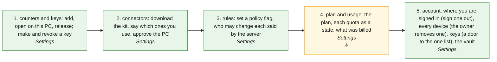

# SET · Shop setup (counters · connectors · rules · plan · account) — the process map from the code

<!-- GENERATED by tools/gen-process-docs.cjs from docs/process/flows.json — edit the JSON, then run the tool. -->

SAP picture: **BC (customising · authorisations · licence)**. One row per step: who does it · the screen · the engine function · the API route · the chit kind · the ledger entry · the test · status. A file is `repo:path` (web = this repo · api = chitbridge-api · engines = chitbridge-engines). A step marked **MISSING** has nothing in the code that does it — the evidence is in its row, nothing is invented. Generated 2026-10-12.

| # | step | module | who | screen (file · function) | engine function | API route | chit kind | ledger entry | test | status |
|---|---|---|---|---|---|---|---|---|---|---|
| 1 | counters and keys: add, open on this PC, release; make and revoke a key | Settings | the owner (every counters write: lib/owner.gate) · any signed-in person reads | `web:public/app/cap-settings.js` `counters()` `web:public/app/cap-settings.js` `ctrOpenTill()` | `api:lib/owner.js` `gate()` `api:routes/keys.js` `mint()` | `GET /api/counters` `api:routes/counters.js` `POST /:id/open` `api:routes/counters.js` `POST /:id/release` `api:routes/counters.js` | none | none | `api:tests/settings-owner-gate.test.cjs` `web:e2e/walk-settings-ops.cjs` | ✅ — A co-assist sees every action greyed with the server's sentence (may.manage, code OWNER_ONLY). |
| 2 | connectors: download the kit, say which ones you use, approve the PC | Settings | the owner | `web:public/app/cap-settings.js` `connectors()` `web:public/app/cap-settings.js` `kitDownload()` | `api:routes/keys.js` `mint()` | `GET /catalogue` `api:routes/integrations.js` `GET /status` `api:routes/integrations.js` `POST /:actor_id/approve` `api:routes/integrations.js` | none | none | `web:e2e/walk-settings-ops.cjs` | ✅ — A connector the shop's country pack does not offer stays listed, its Download greyed with the pack's sentence (CX6). |
| 3 | rules: set a policy flag, who may change each said by the server | Settings | the owner · a co-assist where the server allows | `web:public/app/cap-settings.js` `policy()` `web:public/app/cap-settings.js` `polStored()` | `api:lib/policy.js` `set()` `api:lib/owner.js` `may()` | `GET /policy` `api:routes/entities.js` `PATCH /policy` `api:routes/entities.js` | none | none | `api:tests/settings-owner-gate.test.cjs` `web:e2e/walk-settings-ops.cjs` | ✅ — The labels are POLICY_FLAGS (one list, cap-settings.js); lib/policy FLAGS is the whitelist and the may/why. |
| 4 | plan and usage: the plan, each quota as a state, what was billed | Settings | the owner | `web:public/app/cap-settings.js` `plan()` | `api:lib/plans.js` `quotaOf()` | `GET /entitlements` `api:routes/entities.js` `GET /usage` `api:routes/entities.js` | none | none | `web:e2e/walk-settings-ops.cjs` | ⚠️ — Reporting only: no route gates on plan (enforced:false) and every sellable tier's quotas are not decided — shown as 'Not decided yet', never as unlimited. |
| 5 | account: where you are signed in (sign one out), every device (the owner removes one), keys (a door to the one list), the vault | Settings | any signed-in person (own sessions · the vault); the owner (every device, remove) — may.devices from the server | `web:public/app/cap-settings.js` `account()` `web:public/app/cap-shop.js` `vaultCardHTML()` | `api:lib/person-session.js` `devicesOf()` `api:lib/owner.js` `may()` | `GET /sessions` `api:routes/signin.js` `GET /devices` `api:routes/signin.js` `POST /sessions/revoke` `api:routes/signin.js` `PUT /profile/vault` `api:routes/governance.js` | none | none | `api:tests/account-sessions.test.cjs` `web:e2e/walk-account.cjs` | ✅ — T3-P4-ACCOUNT. The current session's Sign out is greyed (the server's `current`, a field); a co-assist sees Every device greyed with may.devices (code OWNER_ONLY). API keys stay ONE list under Counters & keys. |

## The backlog this map leaves

- **step 4 · plan and usage: the plan, each quota as a state, what was billed** — ⚠️ — Reporting only: no route gates on plan (enforced:false) and every sellable tier's quotas are not decided — shown as 'Not decided yet', never as unlimited.
