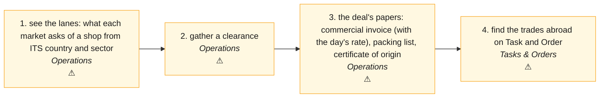

# TRADE · Trade across a border (the lanes a shop can sell into, its clearances, the papers of a deal) — the process map from the code

<!-- GENERATED by tools/gen-process-docs.cjs from docs/process/flows.json — edit the JSON, then run the tool. -->

SAP picture: **GTS (compliance · documents)**. One row per step: who does it · the screen · the engine function · the API route · the chit kind · the ledger entry · the test · status. A file is `repo:path` (web = this repo · api = chitbridge-api · engines = chitbridge-engines). A step marked **MISSING** has nothing in the code that does it — the evidence is in its row, nothing is invented. Generated 2026-10-12.

| # | step | module | who | screen (file · function) | engine function | API route | chit kind | ledger entry | test | status |
|---|---|---|---|---|---|---|---|---|---|---|
| 1 | see the lanes: what each market asks of a shop from ITS country and sector | Operations | anyone in the shop | `web:public/app/cap-readiness.js` `loadLanes()` `web:public/app/cap-readiness.js` `loadLaneReadiness()` | `api:lib/readiness.js` `resolveLaneMatrix()` `api:lib/readiness.js` `laneOf()` `api:lib/readiness.js` `standardApplies()` | `GET /api/governance/lanes` `api:routes/governance.js` `GET /api/governance/readiness` `api:routes/governance.js` | none | none | `api:tests/trade-srv1.test.cjs` | ⚠️ — TRADE-SRV1: the server answers from the shop's stated country and sector (asked when unstated: code ORIGIN_UNSTATED · SECTOR_UNSTATED); AU and AE lanes need b538. The screen still sends paint / IN — the web round follows. |
| 2 | gather a clearance | Operations | the owner or an editor (a viewer is told why not) | `web:public/app/cap-readiness.js` `gatherReadiness()` `web:public/app/cap-readiness.js` `submitGather()` | `api:lib/readiness.js` `gatherDocument()` `api:lib/access.js` `mayWrite()` | `POST /api/governance/compliance` `api:routes/governance.js` `POST /api/governance/verify` `api:routes/governance.js` | none (evidence may name an owned chit) | none | `api:tests/trade-srv1.test.cjs` | ⚠️ — TRADE-SRV1 G8: refused 403 with the rail's sentence and a code; the reads carry may.gather — the screen does not grey with it yet. |
| 3 | the deal's papers: commercial invoice (with the day's rate), packing list, certificate of origin | Operations | the owner or an editor issues · signs · attaches | `web:public/authority-forms.html` `resolve()` `web:public/authority-forms.html` `issue()` `web:public/authority-forms.html` `attach()` | `api:lib/forms.js` `resolveForm()` `api:lib/forms.js` `shopOf()` `api:lib/forms.js` `listInstances()` `api:lib/fx-rates.js` `rateOn()` | `POST /api/forms/:key/resolve` `api:routes/forms.js` `POST /api/forms/:key/issue` `api:routes/forms.js` `GET /api/forms/instances/all` `api:routes/forms.js` | read (the order, context_ref) · the issued paper attaches to it, one copy per party | none | `api:tests/trade-srv1.test.cjs` | ⚠️ — TRADE-SRV1 G4/G5/G7: packing list; ?context_ref= lists one deal's papers; the rate is the owner's for the invoice's day (FX_RATE_MISSING says which rate to add). The screen does not list by deal yet. |
| 4 | find the trades abroad on Task and Order | Tasks & Orders | anyone in the shop | — | `api:lib/country-setup.js` `abroadSql()` | `GET /api/chits/inbox` `api:routes/chits.js` `GET /api/chits/sent` `api:routes/chits.js` | read (summary_json.currency_code, all_recipients) | none | `api:tests/trade-srv1.test.cjs` | ⚠️ — TRADE-SRV1 G3: ?abroad=1 on the shared list filter. No filter chip on the lists yet (the web round). |

## The backlog this map leaves

- **step 1 · see the lanes: what each market asks of a shop from ITS country and sector** — ⚠️ — TRADE-SRV1: the server answers from the shop's stated country and sector (asked when unstated: code ORIGIN_UNSTATED · SECTOR_UNSTATED); AU and AE lanes need b538. The screen still sends paint / IN — the web round follows.
- **step 2 · gather a clearance** — ⚠️ — TRADE-SRV1 G8: refused 403 with the rail's sentence and a code; the reads carry may.gather — the screen does not grey with it yet.
- **step 3 · the deal's papers: commercial invoice (with the day's rate), packing list, certificate of origin** — ⚠️ — TRADE-SRV1 G4/G5/G7: packing list; ?context_ref= lists one deal's papers; the rate is the owner's for the invoice's day (FX_RATE_MISSING says which rate to add). The screen does not list by deal yet.
- **step 4 · find the trades abroad on Task and Order** — ⚠️ — TRADE-SRV1 G3: ?abroad=1 on the shared list filter. No filter chip on the lists yet (the web round).
