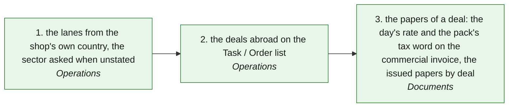

# TRD · Trade (a lane from the shop's own country, its papers by deal, the deals abroad) — the process map from the code

<!-- GENERATED by tools/gen-process-docs.cjs from docs/process/flows.json — edit the JSON, then run the tool. -->

SAP picture: **SD-FT (foreign trade: export documents, country of origin) — the incumbents are a baseline; built on the rail (a paper is a per-copy attachment on the chit)**. One row per step: who does it · the screen · the engine function · the API route · the chit kind · the ledger entry · the test · status. A file is `repo:path` (web = this repo · api = chitbridge-api · engines = chitbridge-engines). A step marked **MISSING** has nothing in the code that does it — the evidence is in its row, nothing is invented. Generated 2026-10-12.

| # | step | module | who | screen (file · function) | engine function | API route | chit kind | ledger entry | test | status |
|---|---|---|---|---|---|---|---|---|---|---|
| 1 | the lanes from the shop's own country, the sector asked when unstated | Operations | any login reads; an editor or the owner gathers / verifies (the server's may/why) | `web:public/app/cap-readiness.js` `loadLanes()` `web:public/app/cap-readiness.js` `_rdDestSelectors()` `web:public/app/cap-readiness.js` `_rdMay()` | `api:lib/readiness.js` `laneContext()` `api:lib/readiness.js` `resolveLaneMatrix()` `api:lib/profile.js` `homeOf()` `api:lib/trade-may.js` `mayWrite()` | `GET /api/governance/lanes` `api:routes/governance.js` `GET /api/governance/readiness` `api:routes/governance.js` `POST /api/governance/compliance` `api:routes/governance.js` | a gathered clearance is a self-chit carrying the document | none | `api:tests/trade-lanes.test.cjs` | ✅ — TRADE-SRV1: origin = identities.country (never IN), AU and AE lanes (b571), domestic derived; no country → 422 TRADE_ORIGIN_UNSTATED with the Country setup button. |
| 2 | the deals abroad on the Task / Order list | Operations | any login of the shop | `web:public/app.html` `advParams()` `web:public/app.html` `advPanel()` | `api:lib/folder-inventory.js` `abroadSql()` | `GET /api/chits/inbox` `api:routes/chits.js` `GET /api/chits/sent` `api:routes/chits.js` | read (the copies whose other party is registered in another country) | none | `api:tests/trade-lanes.test.cjs` | ✅ — ?abroad=1 — one term in the shared filter builder; a party with no country is not abroad. |
| 3 | the papers of a deal: the day's rate and the pack's tax word on the commercial invoice, the issued papers by deal | Documents | an editor or the owner issues, signs, files (the server's may/why); any login reads | `web:public/authority-forms.html` `papersLoad()` `web:public/authority-forms.html` `mayAttr()` | `api:lib/forms.js` `dayRateFor()` `api:lib/forms.js` `listInstances()` `api:lib/fx-rates.js` `rateOn()` | `GET /api/forms` `api:routes/forms.js` `GET /api/forms/instances/all` `api:routes/forms.js` `POST /api/forms/:key/issue` `api:routes/forms.js` `GET /api/books/fx-rates` `api:routes/books.js` | an issued paper files onto the deal's chit as a per-copy attachment | none (the rate is read, never posted here) | `api:tests/trade-forms.test.cjs` | ✅ — TRADE-SRV1 G5–G7: ?context_ref= lists the deal's papers (total · page · limit); the exchange rate is the FX1 reader's day rate, in words with its source and day; GSTIN · ABN · TRN by pack. |

## The backlog this map leaves

Every step is built and tested.
